# Xenosaga Episode II Python Extractor

Unpack, browse, edit and translate **Xenosaga Episode II: Jenseits von Gut
und Böse** (PS2, USA, SLUS-20892 / SLUS-21133) with Python. Point it at your
own disc images and you get the game in forms your computer opens: every
texture as PNG, **every model as a glTF file Blender opens, textured, rigged
and animated with the game's own motion clips**, the field music as MIDI with
a SoundFont made from the game's instruments and a WAV rendered the way the
PS2 plays it, sound effects as WAV, cutscenes as MP4, the scene scripts as
readable assembly, and all of the game's text as UTF-8. Then change it: paint
over a texture, rewrite a line, or translate into an alphabet the game never
had, and the kit writes a patched copy of the disc and checks every byte it
wrote.

<table>
<tr>
<td align="center">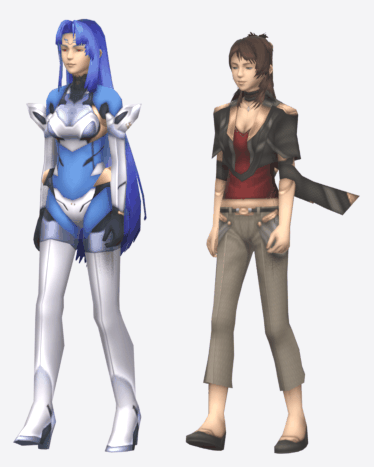</td>
<td align="center">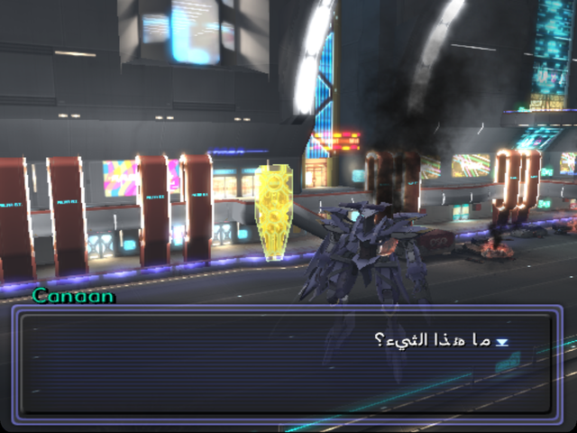</td>
<td align="center">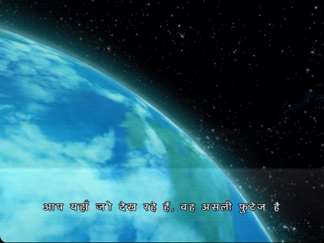</td>
</tr>
<tr>
<td align="center"><sub>KOS-MOS and Shion, exported with their motion<br>and rendered in Blender</sub></td>
<td align="center"><sub>Arabic in the field box, right to left<br>(PCSX2, a disc the kit rebuilt)</sub></td>
<td align="center"><sub>Hindi subtitles in the opening movie<br>(PCSX2, the same disc)</sub></td>
</tr>
</table>

**The kit ships no game data.** You need your own copy of the discs. Every
game picture and sound on this page was made by the kit from the USA discs or
captured from the game running in PCSX2 on a disc the kit patched; nothing is
retouched.

This is the Episode II sibling of the
[Episode I extractor](https://github.com/LinuxJessi/Xenosaga1PythonExtractor)
and the [Episode III extractor](https://github.com/LinuxJessi/Xenosaga3PythonExtractor),
built the same way, with code borrowed from both where the formats are shared
(each borrowed module says so at the top). *New here?
[docs/TOUR.md](docs/TOUR.md) walks through everything the kit does, with
examples.*

**Contents:** [Quick start](#quick-start) · [What it does](#what-it-does) ·
[Models](#models) · [Animation](#animation) ·
[Changing textures](#changing-textures) · [Translating](#translating-into-another-alphabet) ·
[Text coverage](#text-coverage) · [Audio samples](#audio-samples) ·
[Movies, fonts and menus](#movies-fonts-and-menus) · [The window](#the-window) ·
[Regions](#regions-and-the-demo-disc) · [Still open](#still-open) · [Docs](#docs)

## Quick start

**The app.** Version tags build a bundle for Windows and macOS with GitHub
Actions (`.github/workflows/release.yml`), attached to the release on the
Releases page: `Xenosaga-II-Extractor-win64.zip` and
`Xenosaga-II-Extractor-macos.zip`. They carry Python, the packages and ffmpeg;
unzip and double-click. The macOS app is ad-hoc signed, not notarized: the
first time, right-click it and choose Open.

**From a source checkout**, double-click `launch.command` (macOS),
`launch.bat` (Windows) or `launch.sh` (Linux), or run `python gui.py`. The
launchers install the packages into `.venv/` on first run if your Python lacks
them. The window opens as a local page in your browser, finds your disc images
and has one card per command ([below](#the-window)).

**From a terminal** (Python 3.9 or newer):

```sh
python -m pip install -r requirements.txt     # once: numpy, fontTools, uharfbuzz
python cli.py dump    --iso "Disc 1.iso" --iso "Disc 2.iso" --out out/ --code
python cli.py browse  --out out/
```

`dump` unpacks both discs into `out/dump/chain0` (shared by both discs),
`chain1` (Disc 1) and `chain2` (Disc 2), with `out/manifest.csv` listing every
object, its sector, size, sha1 and kind (9,043 objects on the two USA discs).
`browse` converts the dump into `out/browse/`, the folder you open; pick parts
with `--kinds textures,models,xtx,fonts,text,scripts,audio,music,images,movies,small`.
`python cli.py verify --out out/` re-hashes a dump against its manifest.
ffmpeg (movies, voice clips) is used when found. Every module that makes a
claim has a `--self-test`, and `python cli.py self-test` runs them all.

## What it does

| | Command | What you get | More |
|---|---|---|---|
| **Disc** | `list`, `dump`, `verify` | both discs unpacked by chain, a manifest with every object's sector, size, sha1 and kind; `--code` also copies the executables and IOP modules | [BROWSING](docs/BROWSING.md) |
| **Textures** | `browse --kinds textures` | every `.txy` page as PNG, 65,938 of them, named the way the artists named them (`shion00_hair`, `kosmos00_face`), plus 1,333 pages from inside effect files | [BROWSING](docs/BROWSING.md), [FORMATS](docs/FORMATS.md) |
| **UI sheets** | `browse --kinds xtx` | the 85 `.xtx` sheets: citizen portraits, item cards, the title menu words | [FORMATS](docs/FORMATS.md) |
| **Fonts** | `font-extract`, `font-rebuild` | the four glyph sheets of each font as PNG, the proportional metrics, the byte-to-cell table; and a font file rebuilt from edited sheets | [MODDING](docs/MODDING.md) |
| **Models** | `browse --kinds models`, `model` | all 944 `.pxy` meshes as `.glb`: mesh, UVs, textures inside the file, vertex colours, skin weights, and for 562 an armature whose bones sit on the mesh | [BLENDER](docs/BLENDER.md), [MODELS](docs/MODELS.md) |
| **Animation** *(new)* | `model --motion`, `browse` | the `.xap` body and `.fap` face clips as glTF animations, one action per clip at 30 fps: all 4,340 clips on the disc decode, and 142 of the 944 models get their motion automatically | [MOTION](docs/MOTION.md) |
| **Texture import** *(new)* | `texture-import` | painted PNGs, UI sheets and images inside a `.glb` (after a trip through Blender) written back into a copy of the disc, into every copy of the same picture, with shared palettes kept intact; every write decoded again from the new image | [MODDING](docs/MODDING.md#editing-textures-texture-import) |
| **Text** | `text-export`, `text-import` | all the game's text as editable UTF-8 and back: 9,699 dialogue strings in 465 banks, 903 menu strings, the 1,085 battle names and descriptions, quest and citizen text, 45 subtitle files, the save's title in the memory-card browser, and the 416 battle banners; each kind checked against its own limit | [MODDING](docs/MODDING.md#text-text-export--text-import) |
| **Executable strings** | `exe-export`, `exe-import` | the strings in the game's code (`Saving...`, the memory-card and disc-change prompts): 3,498 in SLUS_208.92, 678 in OV01, 47 in OV02, rewritten in place | [MODDING](docs/MODDING.md#executable-strings-exe-export--exe-import) |
| **Text coverage** *(new)* | `text-coverage --verify` | every place the game shows text, counted from your discs, and what the kit does with it; `--verify` checks that every unedited tree imports as no change | [MODDING](docs/MODDING.md#what-is-covered-text-coverage) |
| **New alphabets** *(new)* | `lang-scan`, `lang-encode`, `lang-preview` | a translation shaped with HarfBuzz, its glyphs drawn into both fonts, the text written as glyph codes, right-to-left lines ordered and wrapped; Arabic, Hindi and Amharic seen in the running game | [ALPHABETS](docs/ALPHABETS.md) |
| **Dialogue in play order** | `dialogue --voice` | 8,318 lines (text boxes, messages, choices, timed event lines, battle lines) from 363 scripts with speakers and branches; the 45 movies' subtitles and 80 real-time events as `.srt`; one WAV per timed voice line | [DIALOGUE](docs/DIALOGUE.md) |
| **Scene scripts** | `sb`, `natives`, `browse --kinds scripts` | all 465 scene and map scripts disassembled, every native call named (`talk.msgDtl`, `runtime.mapChange`), every spoken line inline | [SCRIPTS](docs/SCRIPTS.md) |
| **Music** | `browse --kinds music` | the 31 field and menu songs as MIDI, a SoundFont 2 from the song's own samples, and a WAV rendered from KORG's driver rules and the SPU2's reverb (`spu2synth.py`) | [MUSIC](docs/MUSIC.md) |
| **Sound effects** | `browse --kinds audio` | 3,733 named samples from 1,074 KORG banks, as WAV with loop points | [FORMATS](docs/FORMATS.md) |
| **Movies** | `browse --kinds movies` | `.sfd` cutscenes and `.ipu` monitor clips as MP4 (stereo, or the AC3 5.1 track with `--movie-audio`), `.adx` voices as WAV | [BROWSING](docs/BROWSING.md) |
| **Small files** | `browse --kinds small` | boot screens, title logos, the save icon, the battle database's strings, and a table of what every side file is | [small-files](docs/research/small-files.md) |
| **Recolour** | `recolor` | a hue shift of named textures in every copy on the disc (KOS-MOS's hair, pink), with a before/after preview | [MODDING](docs/MODDING.md#recolouring-textures-recolor) |
| **Patch any file** | `patch` | replace objects in a copy of the disc; `--grow` relocates one that outgrows its slot past the end of the image | [MODDING](docs/MODDING.md#any-file-patch) |
| **Japanese discs, *Xenosaga Freaks*** | the reading commands | the Japanese release (SLPS_253.68 / .69) and the 2004 demo on *Xenosaga Freaks* read too; text is edited in place there | [below](#regions-and-the-demo-disc) |
| **The window** | `gui.py`, `build.py` | a local page with a card per command, built from the CLI itself; `build.py` makes the standalone app | [below](#the-window) |

## Models

Every picture below is a `.glb` the kit wrote, rendered in Blender, textured as
the game stores it. The figures stand in the bind pose here (the
[next section](#animation) shows them moving). Source models are under
`model/char/pc`, `model/char/npc` and `model/map`; the render script is
[docs/gallery/render_gallery.py](docs/gallery/render_gallery.py).

### Playable characters

| 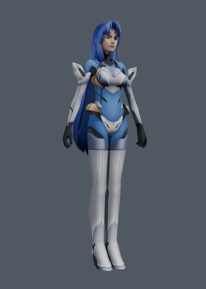 | 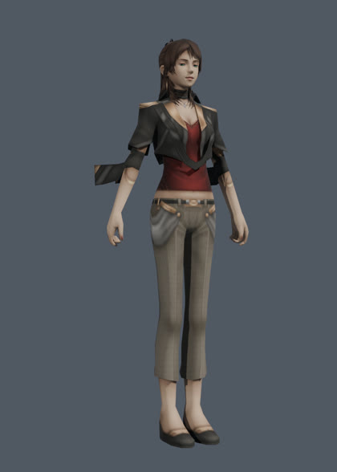 | 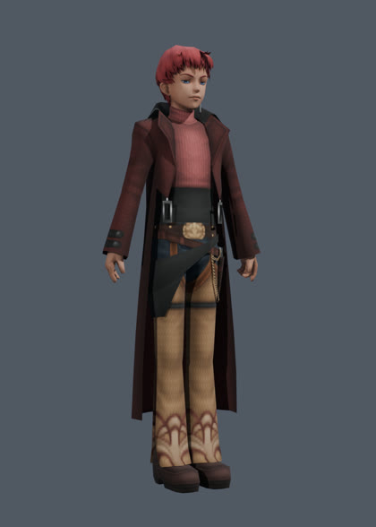 |  |  |  | 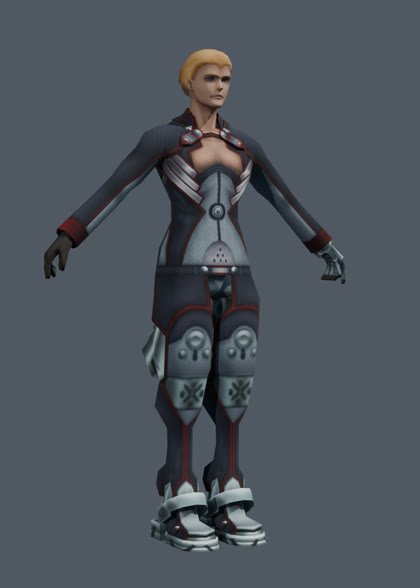 |
| :---: | :---: | :---: | :---: | :---: | :---: | :---: |
| KOS-MOS<br>`kosmos00` | Shion<br>`shion00` | Jr.<br>`jr00` | Jin<br>`jin00` | Chaos<br>`chaos00` | MOMO<br>`momo00` | Ziggy<br>`ziggy00` |

### Notable NPCs

Captions are the model file names; the kit does not carry character names for these.

|  | 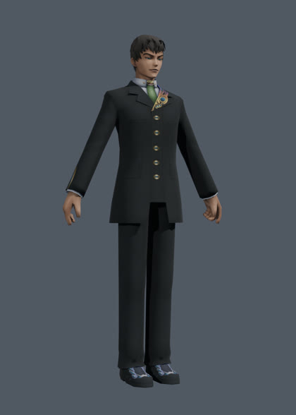 |  | 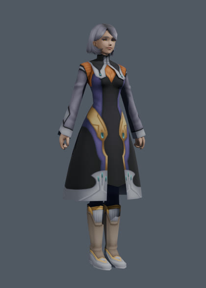 |  |
| :---: | :---: | :---: | :---: | :---: |
| `albelt00` | `gaignun00` | `yuri00` | `febronia00` | `kirsch00` |

|  |  | 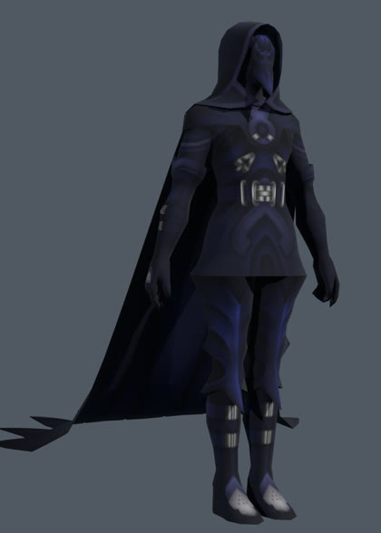 | 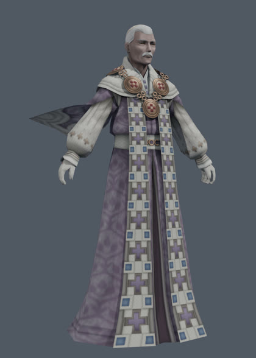 |
| :---: | :---: | :---: | :---: |
| `helmer00` | `miyuki00` | `virgil00` | `pope00` |

### Environments

| | |
|---|---|
| 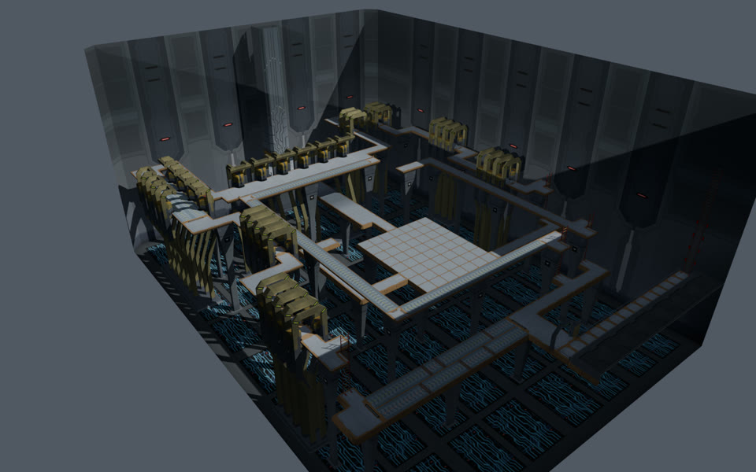<br>`E2_MIL12` | 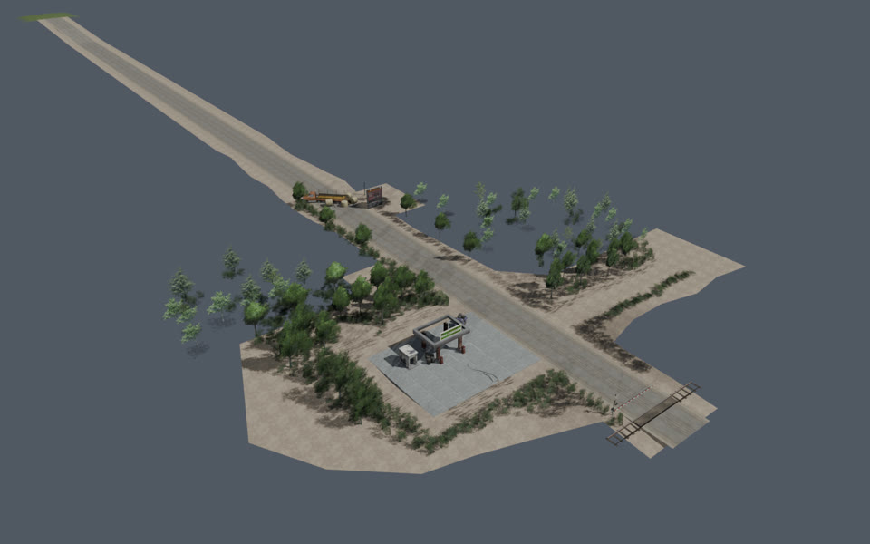<br>`E2_MOM11` |
| 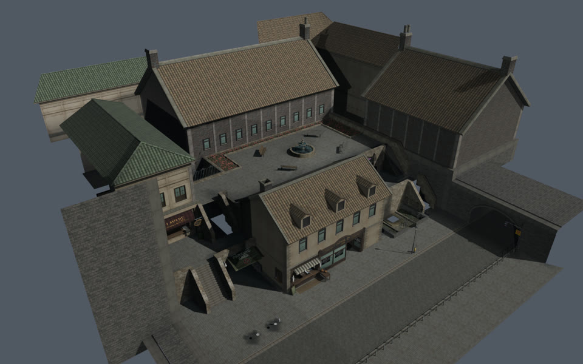<br>`E2_KUK06` | <br>`E2_UZU01` |
| 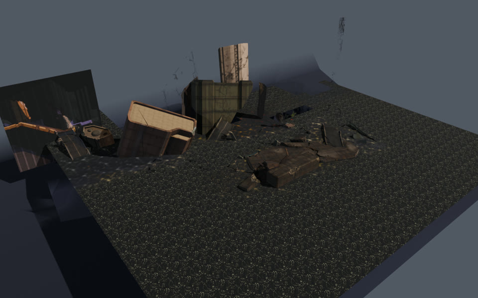<br>`E2_SUI06` | |

Maps are shown from a raised three-quarter view with their sky shells hidden
and back faces culled, so the outer walls do not hide the rooms.

```sh
python cli.py browse --out out/ --kinds models          # all of them, with their motion
python cli.py model  --iso "Disc 1.iso" --path 'model\char\pc\kosmos00.pxy' --out kosmos00.glb   # just one
```

Open a `.glb` with File ▸ Import ▸ glTF 2.0 and switch the viewport to
Material Preview; [docs/BLENDER.md](docs/BLENDER.md) lists the three things
that trip people up on a first look, and what has not been checked against the
running game.

## Animation


The motion files are decoded. Each `.xap` (body) and `.fap` (face) clip
becomes one glTF animation on the model's armature, read the way the
executable reads it: the key types, the compensated joint transforms and the
two roots, written at 30 keys per second. All 4,340 clips in the 550 motion
files decode, and `browse` gives 142 models their same-named clips.

```sh
python cli.py model --iso "Disc 1.iso" --path 'model\char\pc\shion00.pxy' --out shion00.glb \
       --motion 'motion\shion00.xap#0,1,2' --motion 'yamamoto\mot\shio00.xap#0,1' --face
```

The loop on the right is KOS-MOS and Shion playing slot 1 of their field
motion files (`motion/kosmos00#01`, `motion/shion00#01`), straight from the
kit's `.glb` files. The kit reads its files back (joints within 5e-7 of its
own pose, loops closed), the Khronos glTF validator reports no errors,
warnings or infos on them, and Blender's import check finds every action,
bone transform and frame range as written.
`tools/demo/motion.sh` runs the exports and those checks, and
[docs/gallery/render_motion_preview.py](docs/gallery/render_motion_preview.py)
renders the loop. "Walk-like" is the kit's word for
this clip; the game's names for the slots are not known, and none of this
has been compared with the running game. Hair, coats and skirts do not
swing, because the game simulates them and the kit does not.
More in [docs/MOTION.md](docs/MOTION.md).

<br clear="right">

## Changing textures

Paint over any PNG `browse` wrote, or over an image inside a model in Blender,
and give the folder back:

```sh
cp -R out/browse edited/                                           # paint in the copy
python cli.py texture-import --iso "Disc 1.iso" --tree edited/ --dry-run
python cli.py texture-import --iso "Disc 1.iso" --tree edited/ --out modded.iso --preview prev/
```

`texture-import` compares every PNG with what the disc decodes to and writes
only the ones that differ, into a copy of the disc. The game stores the same
picture many times under different names: KOS-MOS's hair is in four files,
each with its palette somewhere else, and one edit reaches all of them. Shared
palettes are kept intact for the other textures that read them. Before the
copy gets its name, every replaced object is read back and decoded: edited
entries must show the planned picture, every other entry its original.

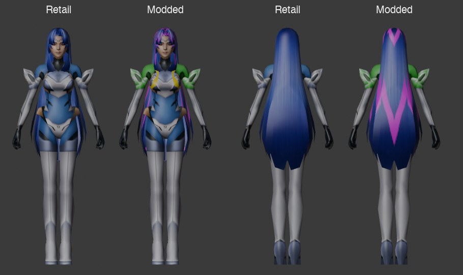

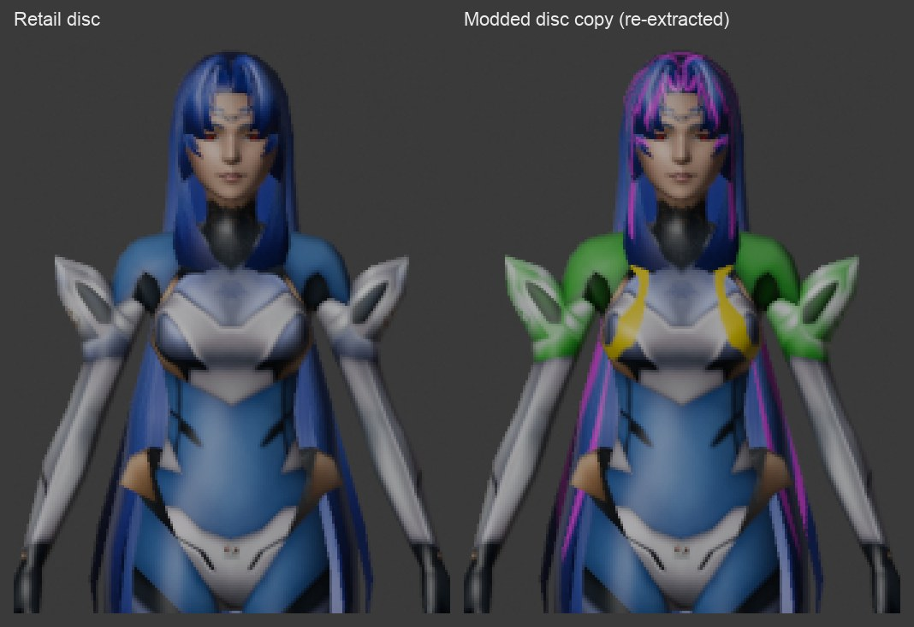

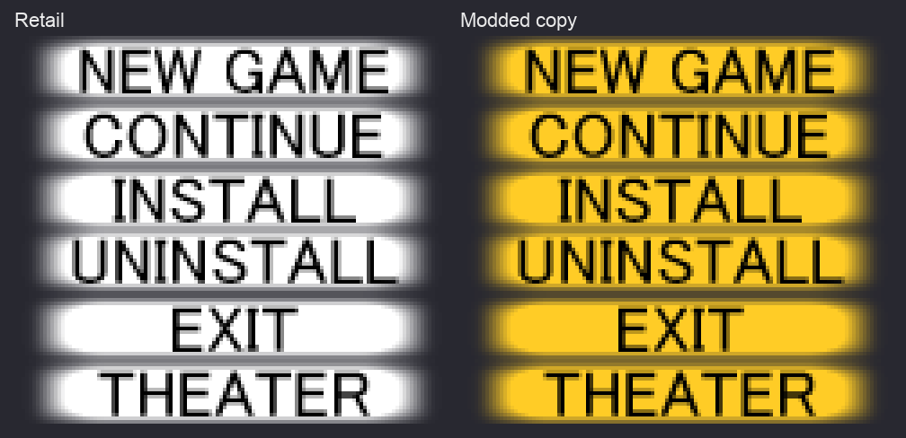

*Both are re-extracted from the modded copy of Disc 1, not from the edited
files: the hair band (in all four of her texture files), the arm texture and
a ring painted on her chest texture through a `.glb` round trip, and the title
menu sheet `yajima\titleobj.xtx` tinted gold. `tools/demo/texture-import.sh`
makes this copy (the renders: [docs/gallery/render_bind_pose.py](docs/gallery/render_bind_pose.py)); its checks pass (10 changed entries in 5 files, every
unrelated object byte-identical), and `--verify-roundtrip` re-encodes all
69,482 texture entries and 73 UI sheets of each USA disc byte-identically.
The copy has not yet been booted in PCSX2.*

The rules (sweeps, palettes, alpha, mip levels, models from Blender) are in
[docs/MODDING.md](docs/MODDING.md#editing-textures-texture-import). The older
`recolor` command still does a quick hue shift; its title-menu recolour is
the one texture change seen in the running game so far.

## Translating into another alphabet

The USA build draws text from a bitmap font with Latin letters only. The kit
does everything another script needs at build time: `lang-scan` shapes the
translation with HarfBuzz and a TrueType font and draws the glyphs it uses
into free cells of both fonts, `lang-encode` writes the tree back with those
glyphs as codes (right-to-left lines reordered, wrapped, every byte limit
checked), and `patch` and `text-import` put fonts and text on a copy of each
disc. The room is 246 codes, 181 of them proportional.

A test disc (LANGTEST) with Arabic, Hindi, Georgian and Amharic was built with
kit commands only (`tools/langtest/langtest.sh`) and played in PCSX2 2.9.175.
These are captures from it, drawn by the game itself. The disc was booted
twice, a first build and a rebuild after review fixes; the Arabic and Hindi
captures are of the rebuild, the two Amharic ones of the first build (the
rebuild draws the same Amharic bitmaps, on codes one cell further on, and
was not captured there):

| | |
|---|---|
| 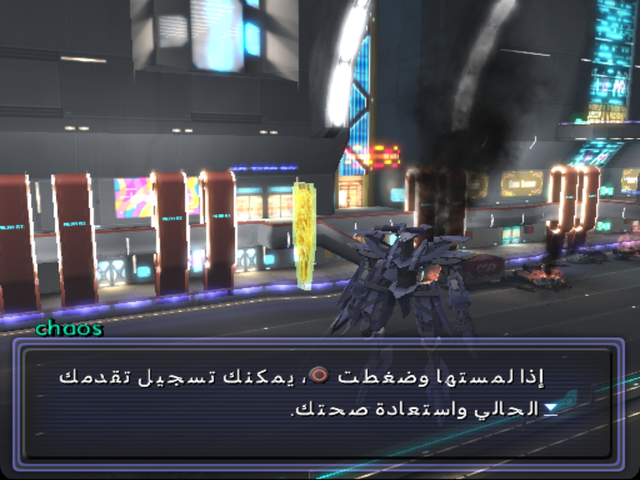 | 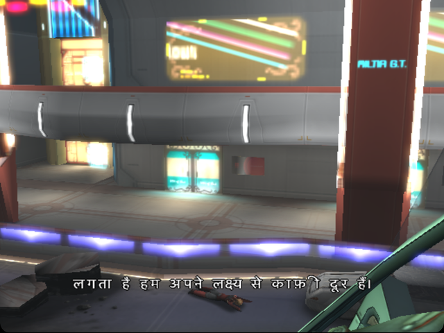 |
| Arabic, two lines in the field box, on one right edge | Hindi, a real-time cutscene line |
| 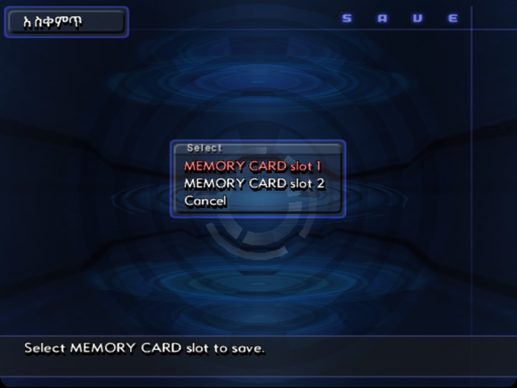 | 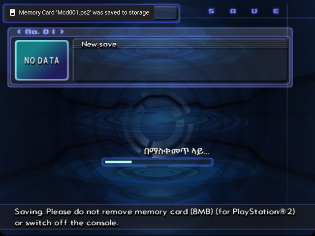 |
| Amharic, the save screen's title (a menu string) | Amharic, `Saving...`, a string in the game's code |

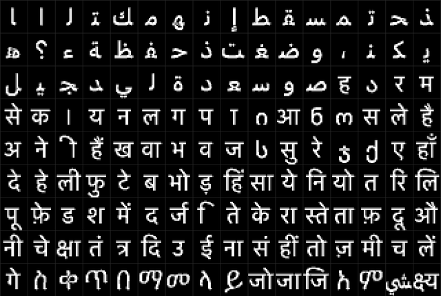

**Seen in the game:** Arabic in the field message box (joined, right to left),
Hindi movie subtitles and cutscene lines, Amharic on the save screen and in
`Saving...`. **Failed:** the party names of the field menu draw blank, in any
script; the name boxes are at fault, not the codes (the Georgian codes draw in
the field box on a test build). **Not reached:** the battle screen. The
merged release builds a LANGTEST image byte-identical to the rebuild that was
played, and its verifier passes (16 translated strings exact, 12,779 untouched
strings and 4,222 executable strings unchanged).

On the right, the 144 cells `lang-scan` drew into both fonts for that disc.
`lang-preview` shows a line without the game:

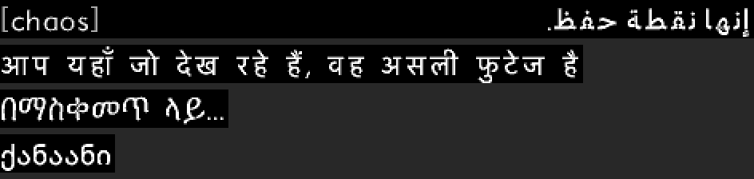

<br clear="right">

The whole procedure, the room and how the engine draws text:
[docs/ALPHABETS.md](docs/ALPHABETS.md). USA discs only; the Japanese build
reads its bytes differently.

## Text coverage

`text-export` writes every kind of text the game keeps as text into one tree
of UTF-8 files; edit the lines, keep the `### NNNN` markers and the game's
codes (`[Speaker]`, `\n`, `$zoom13;`), and `text-import` writes a patched copy. What
you type is read the way the build reads it (on the USA discs `é` is one
Latin-1 byte), and a character the disc's font cannot draw is refused with
the reason. The tree carries a manifest of the disc it came from, so
`text-import` refuses another disc or an already patched one unless you pass
`--rebase`. Executable strings go last (`exe-import`), because afterwards the
executable is no longer the retail one.
`text-coverage` lists every place the game shows text and what the kit does
with each, counted from your discs (it marks the picture rows `export only`,
since no text tool writes them, and says in each row's note when
`texture-import` does):

```sh
python cli.py text-coverage --iso "Disc 1.iso" --iso "Disc 2.iso" --verify
```

| Text | On the USA discs | Writes back |
|---|---|---|
| dialogue and scene text | 465 banks, 9,699 strings | `text-import`; a bank may grow within its loader's room (`--grow`) |
| menus, item, skill and location names, help, the Skill Tutorial | 3 `.txd` files, 903 strings | within the file's sectors; slot placeholders and tutorial commands guarded |
| battle names, descriptions and messages | `batdat.us`, 1,085 strings | strings grow within the file's sectors, the rest of their section moves down |
| battle banners (`bat.namePut`) | 1,363 calls, 416 names in 113 banks | in the bank files |
| quest, citizen and treasure text | 6 files | each text within its field |
| movie subtitles | 45 files | within what the retail subtitles reach |
| the save's title in the memory-card browser | `carddata.bin` | in place |
| strings in the executables | 3,498 + 678 + 47 | `exe-import`, in place, run last |
| words drawn into pictures | UI sheets, texture pages, the title menu | `texture-import` (sheets whose palette is solved) |
| words drawn into JPEG pages and video | "The Story So Far", staff roll | not written by the kit |

`--verify` exports every text and executable string and plans an import of the
unedited trees onto each disc: each plan must change nothing, and on both USA
discs none does. An edit of one string of every kind, imported onto a copy of
Disc 1 and exported again, came back exactly, and the copy differed from the
retail disc in 15 sectors, all in the edited files and the tables of contents.
That copy has not been booted. What you can type, each kind's
limit and the battle banners: [docs/MODDING.md](docs/MODDING.md#text-text-export--text-import).

## Audio samples

Short previews decoded by the kit from Disc 1 (25-second BGM excerpts,
full-length effects and voice lines). GitHub plays these on click or downloads them.

| | Source | Sample |
|---|---|---|
| BGM | `music/001_milchia` | [bgm_001_milchia.mp3](docs/samples/bgm_001_milchia.mp3) |
| BGM | `music/005_morgenroete` | [bgm_005_morgenroete.mp3](docs/samples/bgm_005_morgenroete.mp3) |
| BGM | `music/009_lost_jerusalem` | [bgm_009_lost_jerusalem.mp3](docs/samples/bgm_009_lost_jerusalem.mp3) |
| BGM | `music/103_kukai` | [bgm_103_kukai.mp3](docs/samples/bgm_103_kukai.mp3) |
| BGM | `music/111_moby-dick` | [bgm_111_moby-dick.mp3](docs/samples/bgm_111_moby-dick.mp3) |
| Sound effect | `CFS_SE.vsf` cue CFS00004 | [sfx_CFS_SE_CFS00004.mp3](docs/samples/sfx_CFS_SE_CFS00004.mp3) |
| Sound effect | `CFS_SE.vsf` cue CFS00010 | [sfx_CFS_SE_CFS00010.mp3](docs/samples/sfx_CFS_SE_CFS00010.mp3) |
| Event voice line | real-time event `S05_06_05` (`sc8047`), line 04 | [voice_S05_06_05_04_KOS_MOS.mp3](docs/samples/voice_S05_06_05_04_KOS_MOS.mp3) |
| Event voice line | real-time event `S05_06_05` (`sc8047`), line 05 | [voice_S05_06_05_05_Thank_you.mp3](docs/samples/voice_S05_06_05_05_Thank_you.mp3) |
| Event voice line | real-time event `S05_02_00` (`sc8046`), line 07 | [voice_S05_02_00_07_Oh_be_a_man_already.mp3](docs/samples/voice_S05_02_00_07_Oh_be_a_man_already.mp3) |

The BGM is the kit's own render of the game's MIDI through its own samples,
not a recording; [docs/MUSIC.md](docs/MUSIC.md) says how it was checked
against a game rip and where it still differs. The full sets (music, sound
banks, every cutscene voice line) come out of `browse --kinds music,audio` and
`dialogue --voice` on your own disc.

## Movies, fonts and menus

| | |
|---|---|
| 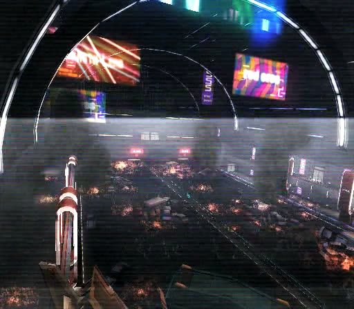 | 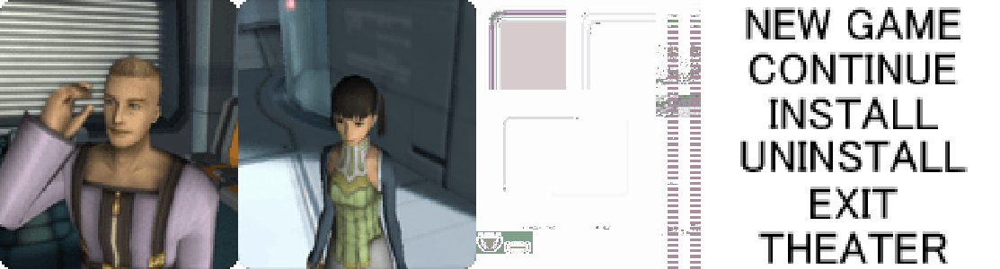 |
| A frame of `s010100.sfd.mp4`, the opening (`browse --kinds movies`) | UI sheets: citizen portraits, interface pieces, the title menu words (`--kinds xtx`) |
| 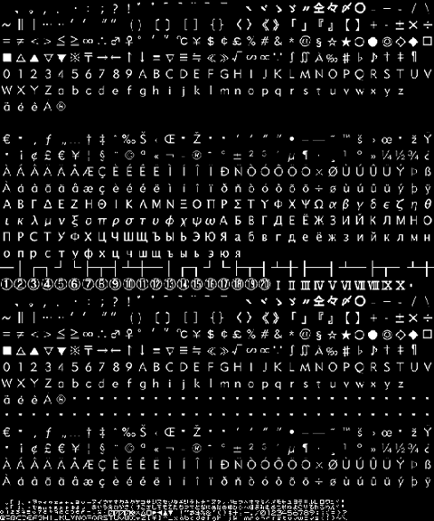 | 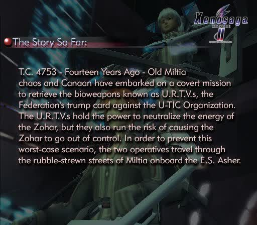 |
| Sheet 0 of the main font (`font-extract`) | "The Story So Far", one of the full-screen JPEGs (`--kinds images`) |
| 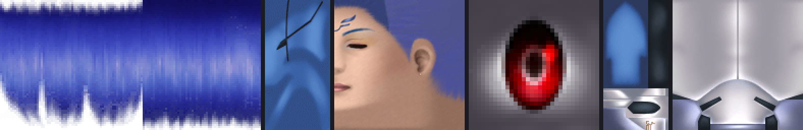 | 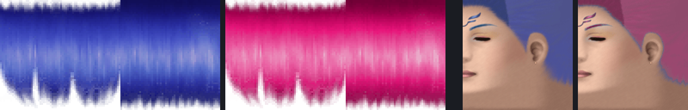 |
| KOS-MOS's texture pages, enlarged (`--kinds textures`) | `recolor --dry-run --preview`: her hair, before and after |

## The window

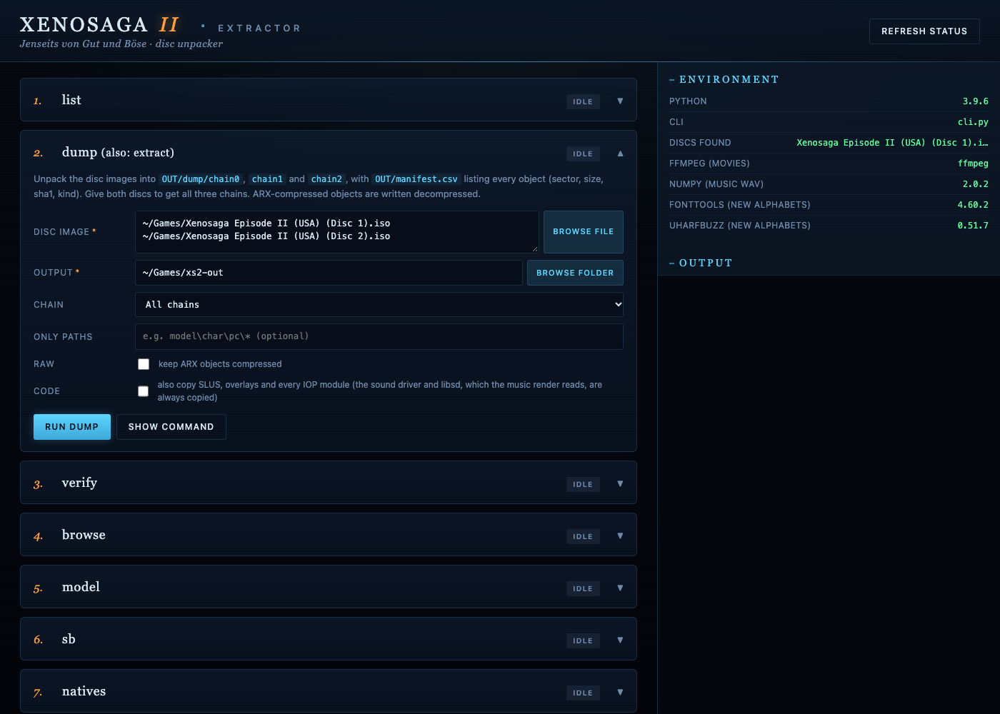

`python gui.py`, or a double-click on a launcher, opens this page on
127.0.0.1. There is one card per command, 22 in all, built from `cli.py`'s own
parser, so a new command appears on its own; each field gets a picker for disc
images and folders, "Show command" prints the command line it will run, and
the output streams into the log on the right. The panel lists the discs found
next to the kit and in the usual folders, and which optional tools are
present. (The disc paths in this screenshot are example names.)

## Regions and the demo disc

The kit reads the build from the disc's boot executable (`region.py`):

| | USA (SLUS_208.92 Disc 1, SLUS_211.33 Disc 2) | Japan (SLPS_253.68 / .69) and the demo |
|---|---|---|
| Dialogue | `.sbl` banks under `en\`; `text-import` rebuilds a bank | inside the `.sb`; `text-import` edits in place, same length or shorter |
| Movie subtitles | `movie\en\*.txt` | `movie\*.txt` |
| Fonts | `font0.us`, `font1.us` | `font0.tex`, `font1.tex` |
| Battle database | `yamamoto\batdat.us` | `yamamoto\batdat.bin` |

Give Disc 1 and Disc 2 of the same region; a mixed pair gets a warning. The
Episode II demo on *Xenosaga Freaks* (SLPS_253.53) works too: its chain sits in
`EXP\` and the kit finds it there. `list`, `dump`, `sb` and `natives` read it;
its scripts are the older form with their Japanese (EUC-JP) text inside the
`.sb`, which `sb` shows inline and `natives --out` writes to `strings.tsv`
([docs/SCRIPTS.md](docs/SCRIPTS.md)). New alphabets and the executable-string
grammar are USA only.

## How it is built

The same reading stack as the Episode I kit: `iso9660.py` (files on the
disc), `chains.py` (the bigfiles as one byte space), `toc.py` (the table of
contents, including the name compression Episode II added), `arx.py`
(Monolith's compression). Decoders: `txy.py`, `xtx.py`, `font.py`, `pxy.py`,
`xhr.py`, `xap.py`, `sbl.py`, `sb.py`, `vsf.py`, `prj.py`, `songfx.py`,
`spu2synth.py`, `midi.py`, `smallfiles.py`; `browse.py` maps them over a dump.
`repack.py`, `textpack.py`, `exetext.py`, `teximport.py`, `glyphs.py`,
`langpack.py` and `recolor.py` write back, `coverage.py` counts the text, and
`gui.py`, `build.py` and `toolfind.py` are the window, the app build and the
ffmpeg finder. `tools/` holds the scripts that build the LANGTEST disc and run
the motion and texture demos. The code tour is
[docs/CODEBASE.md](docs/CODEBASE.md).

Every write goes to a copy of the disc, never the original, and produces a
complete image or none: changed objects are written in place, or relocated
past the end of the image with `--grow`, and read back before the copy takes
its name. Relocating a file past the end of Disc 1 is proven in the game.

## Still open

* **Not yet seen in the running game:** the `texture-import` demo (the PCSX2
  boot check is pending), the motion (playback rate, mirroring), text edits
  other than subtitles and the LANGTEST lines, `text-import --grow` for a
  dialogue bank, and the USA quest characters.
* **Translation:** the field menu's party names draw blank in a new script,
  and why the name boxes draw nothing has not been read. The battle screen was
  not reached, so the battle names are untested. `--tight` spacing has not been
  seen in the game. The Japanese build's glyph space is not worked out.
* **Motion:** the simulated hair and cloth stay stiff, the visibility lists are
  not applied, the game's real-time playback rate is unverified, 331 motion
  files whose name differs from any model's are not paired automatically, and
  189 same-named clips whose block counts differ from the skeleton's (some
  plainly another model's) are written flagged, since which clip the game plays
  on which skeleton is not traced ([MOTION](docs/MOTION.md)).
* **Models:** faces are oriented by their normals and materials are
  double-sided, because about one triangle in thirty is stored facing the other
  way; `mobj241` fails that facing check and is written anyway. Fifteen
  skeletons differ from their mesh's bind pose on some joints. Whether models
  come out mirrored, the colour scale and the alpha modes have not been checked
  against the game ([BLENDER](docs/BLENDER.md)).
* **Textures:** the 11 multi-palette menu sheets (`yosikawa\obj01.xtx`,
  `ctrl01.xtx`, `yamamoto\stat\stat.xtx` and others) still come out grey or
  garbled, because which palette each sprite uses must be read from the menu
  code ([FORMATS](docs/FORMATS.md)), and the twelve UI sheets drawn with a
  guessed palette cannot be written. When the other textures of a shared palette use every slot (45.6%
  of the cases for 256-colour palettes), an edit can only use the existing
  colours unless `--palette joint` is given. The title sheet grown past its
  slot (`--grow`) has not been checked in the game.
* **Text:** subtitle text can only grow by a few bytes per movie, and the true
  limit is not settled ([MODDING](docs/MODDING.md#checked-in-the-running-game-pcsx2-29-2026-11-05)).
  Words drawn into the JPEG pages and the movies have no writer. A second
  language would need a code change: the USA build reads only its `en` folders.
* **Music:** the renders sit close to a game rip on the five songs compared,
  but portamento, the pitch envelope, the driver's volume sweeps and the
  songs' loop points are not modelled, and the low drums decay a few dB
  differently. A PSF2 rip would allow sample-exact checks ([MUSIC](docs/MUSIC.md)).

## Docs

| Read this | When you want to |
|---|---|
| [TOUR.md](docs/TOUR.md) | see everything the kit does, with real output |
| [BROWSING.md](docs/BROWSING.md) | know what `browse` writes and where to look first |
| [BLENDER.md](docs/BLENDER.md) | bring the models into Blender |
| [MODELS.md](docs/MODELS.md), [MOTION.md](docs/MOTION.md) | understand the mesh, skeleton and motion formats and how each part was proven |
| [MODDING.md](docs/MODDING.md) | change the game: textures, text, executable strings, coverage, any file |
| [ALPHABETS.md](docs/ALPHABETS.md) | translate into a script the game never had |
| [DIALOGUE.md](docs/DIALOGUE.md) | get every line in play order, with subtitles and voice clips |
| [SCRIPTS.md](docs/SCRIPTS.md) | read the scene scripts and the script machine |
| [MUSIC.md](docs/MUSIC.md) | render the music and see how the renderer was checked |
| [FORMATS.md](docs/FORMATS.md) | see the byte layout of every format and how it was proven |
| [CODEBASE.md](docs/CODEBASE.md) | find your way around the code and `tools/` |
| [FINDS.md](docs/FINDS.md), [HISTORY.md](docs/HISTORY.md) | read about curiosities left on the disc and the background |
| [UPDATES.md](docs/UPDATES.md) | see what changed, release by release |

## Credits and licence

MIT licence ([LICENSE](LICENSE)). Built on the Episode I and Episode III
kits, and each borrowed module names its source at the top. From the
Episode I kit: the disc reader, the ARX compression (first learned from
[Lakuwu's xenotool](https://github.com/Lakuwu/xenotool) there), the glyph and
shaping modules (`glyphs.py`, `langpack.py`) and the overlay-string reader
behind `exetext.py`. From the Episode III kit: the texture decoder `txy.py`
started from its `chrtex.py`, and `recolor` uses its colour maths. Text
shaping uses HarfBuzz through uharfbuzz, fonts are read with fontTools, and
the models were checked with the Khronos glTF validator and Blender.

Xenosaga Episode II was made by Monolith Soft and published by Namco. This
project is not affiliated with either and contains no game data.

**Sibling kits:** [Episode I](https://github.com/LinuxJessi/Xenosaga1PythonExtractor) ·
[Episode III](https://github.com/LinuxJessi/Xenosaga3PythonExtractor)
