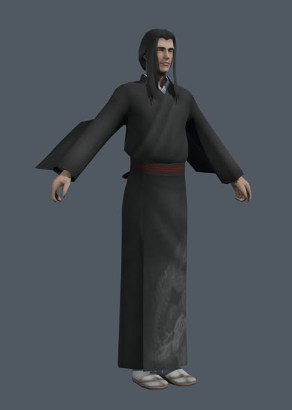
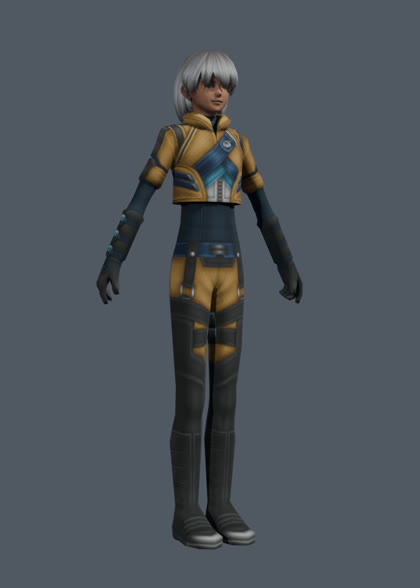
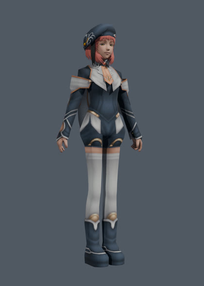
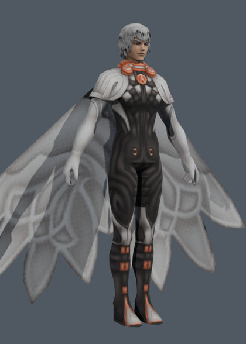
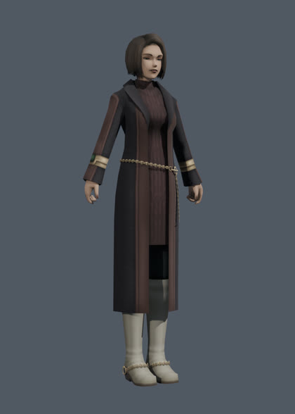
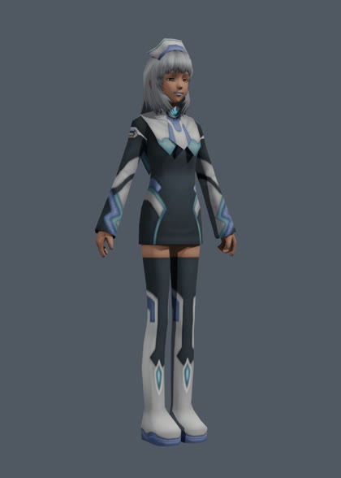
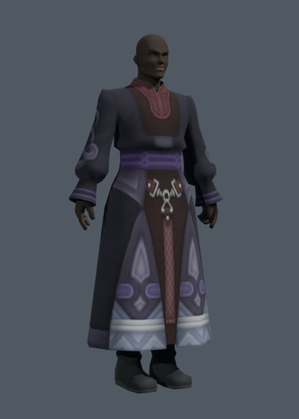
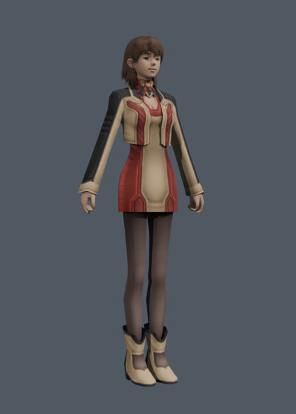
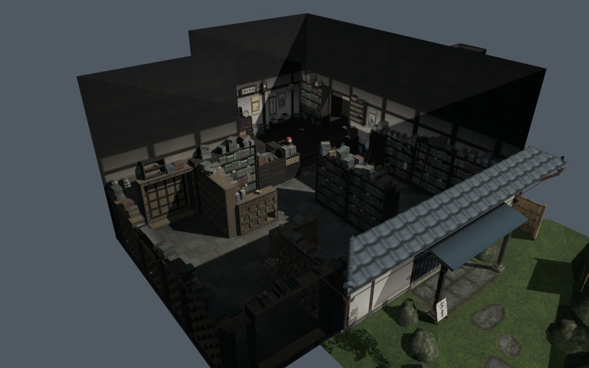

# Xenosaga Episode II Python Extractor

Unpack, browse and edit **Xenosaga Episode II: Jenseits von Gut und Böse**
(PS2, USA, SLUS-20892 / SLUS-21133) with Python and numpy. Point it at your
own disc images and you get the game's files in forms your computer opens:
textures as PNG, **every model as a glTF file Blender opens, textured and
rigged**, sound effects and samples as WAV, the field music as MIDI
with a SoundFont made from the game's own instruments and a WAV rendered the
way the PS2 plays it, dialogue as UTF-8 text you can edit and write back,
the scene scripts as readable assembly with the lines they speak, cutscenes
as MP4.

The kit ships no game data. You need your own copy of the discs.

This is the Episode II sibling of the
[Episode I extractor](https://github.com/LinuxJessi/Xenosaga1PythonExtractor)
and the [Episode III extractor](https://github.com/LinuxJessi/Xenosaga3PythonExtractor),
built the same way, with code borrowed from both where the formats are shared
(each borrowed module says so at the top).

## Gallery

*New here? [docs/TOUR.md](docs/TOUR.md) walks through everything the kit does, with examples.*

Every picture below is a `.glb` the kit wrote, rendered in Blender, textured as
the game stores it. Nothing is retouched; the figures stand in the bind pose
because the motion files are not decoded. Source models are under
`model/char/pc`, `model/char/npc` and `model/map`; the render script is
[docs/gallery/render_gallery.py](docs/gallery/render_gallery.py).

### Playable characters

|  |  |  |  |  |  |  |
| :---: | :---: | :---: | :---: | :---: | :---: | :---: |
| KOS-MOS<br>`kosmos00` | Shion<br>`shion00` | Jr.<br>`jr00` | Jin<br>`jin00` | Chaos<br>`chaos00` | MOMO<br>`momo00` | Ziggy<br>`ziggy00` |

### Notable NPCs

Captions are the model file names; the kit does not carry character names for these.

|  |  |  |  |  |
| :---: | :---: | :---: | :---: | :---: |
| `albelt00` | `gaignun00` | `yuri00` | `febronia00` | `kirsch00` |

|  |  |  |  |
| :---: | :---: | :---: | :---: |
| `helmer00` | `miyuki00` | `virgil00` | `pope00` |

### Environments

| | |
|---|---|
| <br>`E2_MIL12` | <br>`E2_MOM11` |
| <br>`E2_KUK06` | <br>`E2_UZU01` |
| <br>`E2_SUI06` | |

Maps are shown from a raised three-quarter view with their sky shells hidden
and back faces culled, so the outer walls do not hide the rooms.

### Audio samples

Short previews decoded by the kit from Disc 1 (25-second BGM excerpts,
full-length effects and voice lines). GitHub plays these on click or downloads them.

| | Source | Sample |
|---|---|---|
| BGM | `music/001_milchia` | [bgm_001_milchia.mp3](docs/samples/bgm_001_milchia.mp3) |
| BGM | `music/005_morgenroete` | [bgm_005_morgenroete.mp3](docs/samples/bgm_005_morgenroete.mp3) |
| BGM | `music/009_lost_jerusalem` | [bgm_009_lost_jerusalem.mp3](docs/samples/bgm_009_lost_jerusalem.mp3) |
| BGM | `music/103_kukai` | [bgm_103_kukai.mp3](docs/samples/bgm_103_kukai.mp3) |
| BGM | `music/111_moby-dick` | [bgm_111_moby-dick.mp3](docs/samples/bgm_111_moby-dick.mp3) |
| Jingle | `music/203_game_over` (7 s, whole) | [bgm_203_game_over.mp3](docs/samples/bgm_203_game_over.mp3) |
| Sound effect | `CFS_SE.vsf` cue CFS00004 | [sfx_CFS_SE_CFS00004.mp3](docs/samples/sfx_CFS_SE_CFS00004.mp3) |
| Sound effect | `CFS_SE.vsf` cue CFS00010 | [sfx_CFS_SE_CFS00010.mp3](docs/samples/sfx_CFS_SE_CFS00010.mp3) |
| Movie voice line | scene `S05_06_05`, line 04 | [voice_S05_06_05_04_KOS_MOS.mp3](docs/samples/voice_S05_06_05_04_KOS_MOS.mp3) |
| Movie voice line | scene `S05_06_05`, line 05 | [voice_S05_06_05_05_Thank_you.mp3](docs/samples/voice_S05_06_05_05_Thank_you.mp3) |
| Movie voice line | scene `S05_02_00`, line 07 | [voice_S05_02_00_07_Oh_be_a_man_already.mp3](docs/samples/voice_S05_02_00_07_Oh_be_a_man_already.mp3) |

The full sets (music, sound banks, every cutscene voice line) come out of
`browse --kinds music,audio` and `dialogue --voice` on your own disc.

## Running it

Python 3.9 or newer, and numpy (the music renderer needs it). The app
bundles carry numpy, the launchers install it into `.venv/` on first run if
your Python lacks it, and from a terminal you install it once (first line
below). ffmpeg (movies) is used when found; the app bundles carry it too.

```sh
python -m pip install -r requirements.txt     # once: numpy
python cli.py dump    --iso "Disc 1.iso" --iso "Disc 2.iso" --out out/ --code
python cli.py verify  --out out/
python cli.py browse  --out out/
```

`dump` unpacks both discs into `out/dump/chain0` (shared by both discs),
`chain1` (Disc 1) and `chain2` (Disc 2), with `out/manifest.csv` listing
every object, its sector, size, sha1 and kind. `verify` re-hashes the dump
against the manifest. `browse` converts it into `out/browse/`; pick parts
with `--kinds textures,xtx,fonts,text,scripts,audio,music,images,movies`.

Other commands:

```sh
python cli.py list        --iso "Disc 1.iso"
python cli.py sb          --iso "Disc 1.iso" --path 'cf\sc1010.sb'
python cli.py natives     --iso "Disc 1.iso" --iso "Disc 2.iso" --out natives/   # every native: calls, argument types, listings
python cli.py text-export --iso "Disc 1.iso" --out text/
python cli.py dialogue    --iso "Disc 1.iso" --iso "Disc 2.iso" --out lines/ --voice   # every line, in play order, with voice clips
python cli.py text-import --iso "Disc 1.iso" --text text/ --out modded.iso
python cli.py font-extract --iso "Disc 1.iso" --out font/         # sheets as PNG, metrics, byte-to-cell table
python cli.py font-rebuild --ref font/font0.us --sheets font/ --out new_font0.us
python cli.py patch       --iso "Disc 1.iso" --out modded.iso --set 'chain0:cf\en\sc1010.sbl=new.sbl' [--grow]
python cli.py recolor     --iso "Disc 1.iso" --out pink.iso          # KOS-MOS's hair, every copy
python cli.py self-test
```

Every module that makes a claim has a `--self-test`.

The Episode II demo on *Xenosaga Freaks* (SLPS_253.53) works too: its chain sits in
`EXP\` and the kit finds it there. `list`, `dump`, `sb` and `natives` read it; its
scripts are the older form with their (Japanese, EUC-JP) text inside the `.sb` instead
of an `.sbl`, which `sb` shows inline and `natives --out` writes to `strings.tsv`
([docs/SCRIPTS.md](docs/SCRIPTS.md)).

**Regions.** The kit reads the build from the disc's boot executable (`region.py`):

| | USA (SLUS_208.92 Disc 1, SLUS_211.33 Disc 2) | Japan (SLPS_253.68 / .69) and the demo |
|---|---|---|
| Dialogue | `.sbl` banks under `en\`; `text-import` rebuilds a bank | inside the `.sb`; `text-import` edits in place, same length or shorter |
| Movie subtitles | `movie\en\*.txt` | `movie\*.txt` |
| Fonts | `font0.us`, `font1.us` | `font0.tex`, `font1.tex` |
| Battle database | `yamamoto\batdat.us` | `yamamoto\batdat.bin` |

Give Disc 1 and Disc 2 of the same region; a mixed pair gets a warning.

Prefer a window? `python gui.py` (or double-click `launch.command` on a Mac,
`launch.bat` on Windows, `launch.sh` on Linux) opens a local page with a card
per command; the cards are built from the CLI itself, so new commands appear
on their own. `python build.py` makes a standalone app with PyInstaller
(`packaging/`), and `.github/workflows/release.yml` builds release bundles.

## What you get

| | |
|---|---|
| Models | all 944 `.pxy` meshes (941 on the Japanese disc, 666 in the demo) as `.glb`: mesh, UVs, textures inside the file, vertex colours, skin weights and, for the 562 with a usable skeleton file, an armature whose bones sit on the mesh. `browse` writes them all; `model` does one straight from the disc ([docs/BLENDER.md](docs/BLENDER.md), [docs/MODELS.md](docs/MODELS.md)) |
| Textures | every `.txy` page: 65,938 PNGs, named the way the artists named them (`shion00_hair`, `kosmos00_face`), skybox faces and animated pages one per bank; plus 1,333 more from the pages inside effect files (`textures_png/_embedded/`) |
| UI sheets | the 85 `.xtx` sheets: citizen portraits, item icons, the title menu words |
| Fonts | the four glyph sheets of each font, plus the proportional metrics |
| Dialogue | all 465 text banks (9,699 lines) as editable UTF-8; menus, movie subtitles, quest text |
| Dialogue lines | `dialogue`: every spoken line in play order (8,318 lines from 363 scripts, speakers split off, branches and choices marked), the 45 movies' subtitles and 80 real-time events as `.srt`, and with `--voice` one WAV per timed line ([docs/DIALOGUE.md](docs/DIALOGUE.md)) |
| Scripts | all 465 scene and map scripts disassembled, with every native call named (`talk.msgDtl`, `runtime.mapChange`) and every spoken line inline |
| Sound | 3,733 named samples from 1,074 KORG banks, as WAV with loop points |
| Music | the 31 field and menu songs: the MIDI, a SoundFont 2 from the song's own project, and a WAV rendered the way the PS2 plays it, from KORG's driver rules and the SPU2's own reverb with the disc's presets (`spu2synth.py`). Checked against a game rip on five songs ([docs/MUSIC.md](docs/MUSIC.md)) |
| Small files | `--kinds small`: boot screens, title logos, the save icon, the 1,085 battle strings of `batdat.us`, and a table of what every map/effect/motion side file is (`smallfiles.py`) |
| Movies | `.sfd` cutscenes and `.ipu` monitor clips to MP4 (ADX stereo, or the AC3 5.1 track with `--movie-audio ac3`/`both`), `.adx` voices to WAV |

## Writing back

`text-export` writes one file per text bank; edit the lines, keep the
`### NNNN` markers and the game's codes (`[Speaker]`, `\n`, `$zoom13;`).
It also writes the menus (`yosikawa\*.txd` as `X.txd.txt`), the movie
subtitles (`X.sub.txt`), the quest and citizen text (`iwase\*.txt`,
Shift-JIS, as `X.sjis.txt`) and the battle database's names and descriptions
(`batdat.us.txt`). Each kind has its own limit, and `text-import` says which
one an edit broke: menus and quest text may not need more sectors than the
original, subtitle text must stay inside what the retail subtitles reach,
battle strings may not get longer, and `--grow` relocates a dialogue bank
within the room its loader has ([docs/MODDING.md](docs/MODDING.md)).

What you type is read the way the build reads it: on the USA discs `é` is one
Latin-1 byte, on the Japanese discs text is EUC-JP, and a character the
disc's font cannot draw is refused with the reason. A line that starts with
`#` inside a block is a comment (write `⟦23⟧` for a real `#` there). The tree
carries a manifest of the disc it came from; `text-import` refuses another
disc or an already patched one unless you pass `--rebase`, never writes over
its input, and produces a complete image or none.
`text-import` rebuilds every changed bank, refuses the whole import if one
no longer fits its slot on the disc, and patches a copy of the disc in place,
reading every write back. Lines may grow or shrink inside the slot. A
same-length edit changes exactly the edited bytes of the image (checked).
Checked in PCSX2: a recoloured title menu, and subtitle files rewritten and
relocated past the end of the image (docs/MODDING.md).

## How it is built

The same reading stack as the Episode I kit: `iso9660.py` (files on the
disc), `chains.py` (the bigfiles as one byte space), `toc.py` (the table of
contents, including the name compression Episode II added), `arx.py`
(Monolith's compression). Decoders: `txy.py`, `xtx.py`, `font.py`, `sbl.py`,
`sb.py`, `vsf.py`, `prj.py`, `songfx.py`, `spu2synth.py`, `midi.py`, `smallfiles.py`; `browse.py`
maps them over a dump; `repack.py`, `textpack.py` and `recolor.py` write back;
`gui.py`, `build.py` and `toolfind.py` are the window, the app build and the
ffmpeg finder. Byte layouts and how each was proven:
[docs/FORMATS.md](docs/FORMATS.md). Writing your own changes:
[docs/MODDING.md](docs/MODDING.md). What `browse` writes:
[docs/BROWSING.md](docs/BROWSING.md). Music and the KORG driver:
[docs/MUSIC.md](docs/MUSIC.md). The script machine: [docs/SCRIPTS.md](docs/SCRIPTS.md).
Small side files: [docs/research/small-files.md](docs/research/small-files.md).
Curiosities left on the disc: [docs/FINDS.md](docs/FINDS.md); background:
[docs/HISTORY.md](docs/HISTORY.md); the code tour: [docs/CODEBASE.md](docs/CODEBASE.md).
Changes: [docs/UPDATES.md](docs/UPDATES.md).

## Still open

* Models: motion (`.xap`, `.fap`) is not decoded, so bones pose but nothing
  plays. Faces are oriented by their normals and materials are double-sided,
  because about one triangle in thirty is stored facing the other way.
  Fifteen skeletons differ from their mesh's bind pose on some joints. Whether
  models come out mirrored, the colour scale and the alpha modes have not
  been checked against the running game ([docs/BLENDER.md](docs/BLENDER.md)).
* Two multi-palette menu sheets (`yosikawa\obj01.xtx`, `ctrl01.xtx`).
* Music: the renders follow the driver and the SPU2 and sit close to a game
  rip on the five songs compared, but portamento, the pitch envelope, the
  driver's volume sweeps and the songs' loop points are not modelled, and the
  low drums still decay a few dB differently from the rip. A PSF2 rip would
  allow sample-exact checks (docs/MUSIC.md).
* Subtitle text can only grow by a few bytes per movie (the engine stores it in
  front of the movie decoder's work area; see docs/MODDING.md). Relocating a
  file past the end of the disc image is proven in the game.
