# Translating into another alphabet: Arabic, Hindi, Georgian and the rest

The USA build of Episode II draws text one cell at a time, left to right,
from a bitmap font that holds Latin letters and a few symbols. Everything a
different script needs (letters the font never had, joining forms,
right-to-left order, conjuncts) is done by the kit at build time, and the
game only ever sees a stream of glyph codes. Three commands do it:
`lang-scan` draws the glyphs into the fonts, `lang-encode` writes the
translated text as codes, `lang-preview` shows a line without the game.

This is the Episode II counterpart of the Episode I kit's page of the same
purpose (its `docs/SCRIPTS.md`; in this kit `SCRIPTS.md` is about the script
machine). The two modules, `glyphs.py` and `langpack.py`, are borrowed from
the Episode I kit and say so at the top; the addressing, the tiers and the
budgets below are Episode II's own.

**USA build only** (SLUS_208.92 / SLUS_211.33, one executable, sha256
1f978e64c837f9b5...). The Japanese discs read every byte from 0xA0 up as the
lead of a two-byte code, can print kanji and have 192 proportional cells: a
different glyph space, not worked out here. `lang-scan` refuses any other
build and names the serial it saw.

## What is proven and what is not

Proven on disc copies (2026-11-20, the checks at the end of this page): the
fonts the kit writes read back to the byte and change only the cells it
allocated; every code in an imported string decodes, through a port of the
game's own reading, to the cell the encoder meant; `text-import` accepts
the result, including its subtitle checks; Disc 1 and Disc 2 take the same
fonts and chain 0 text.

**Seen in the running game** (PCSX2 2.9.175, the LANGTEST disc, 2026-11-20;
the worked example at the end of this page): lone bytes 0x80-0x9F and
0xA0-0xFF in movie subtitles and cfe cutscene lines (both drawn with
font0) and in the field message window (font1, a scratch build), lone bytes D9-E0 in the save screen's title (a `.txd` menu string)
and in an executable string (`Saving...`), A4 pairs from A4A6 up in the
field message window, and AD cells in the field window, movie subtitles,
cfe lines and the save screen's title. Right-to-left lines pre-wrapped at
410 px are left alone by the field window; subtitle and cfe lines are
centred per line. On the first build one ligature wider than its cell was
cut off; the kit now draws such a glyph narrower, and the rebuild shows it
whole (see the worked example).

**Failed in the running game:** the party names of the field menu
(`MainMenu.txd` blocks 0000, 0003, 0012) are drawn blank. A scratch build
showed that the name boxes are at fault, not the codes: the Georgian codes
draw in the field window, and Hindi on codes the movie draws is blank in
the name box too. Why the name boxes draw nothing has not been read.

**Not reached or not tested:** the battle HUD (`batdat.us`, and whether it
takes names from `batdat.us` or `MainMenu.txd`), `--tight`, and which face
each surface uses (both faces
carry every glyph, so the captures do not tell them apart). Everything else
about how the engine draws is read from the executable.

## How the game draws text (read from SLUS_208.92)

* **One print path.** Every visible string goes through the print function
  `FUN_00197bb8` and the width function `FUN_00195938` (`font.Measurer`).
  With `$han1;` ASCII 0x20-0x7F is drawn from font cells through a table in
  the executable; bytes from 0x80 up always are.
* **Which high bytes pair.** `FUN_00194dd0` (`font.us_two_byte`) reads a byte
  as the lead of a two-byte code only for lead A4, A6 or AD (any non-zero
  trail), A1 with BD DA DB DF F9 FA FB, and A2 with A2 A3 A4 F6. Every other
  high byte is ONE character, cell = byte + 0x80.
* **Proportional drawing.** With `$prop1;` a cell below 384 is drawn from its
  proportional image at cell + 576, columns left - 1 to right + 1 of its
  metric pair (`font + 0x78040 + 2 * cell`), and the pen moves
  right - left + 3. A left of 0 means the advance is `$xx1` + 1. Cells from
  384 up are drawn whole and advance 19. Every UI format string the code
  builds sets `$han1;$prop1;` (the menus at 0x6883F0..0x68B810, the subtitle
  state at 0x6883F0, the cfe formatter `FUN_0024b450` at 0x68CD88, the save
  screen `FUN_00237830`, battle `$han1;%s` at 0x68D570).
* **Two faces, one buffer** (new, 2026-11-20). The engine has one font buffer
  (0x8DD280). `FUN_00198ff0` loads `font1.us` at init, so font1 draws field
  dialogue, menus and battle. `font0.us` is swapped in while a movie plays
  (`FUN_001e7d08`) and between cfe.init (`FUN_0024c308`) and cfe.destroy
  (`FUN_0024e738`), the real-time cutscenes. Measured: sheet 0 (cells
  0-1023) and all 384 metric pairs are byte-identical in the two retail
  files. `lang-scan` writes every glyph into both and checks they still agree.
* **Wrapping.** The field message window wraps by itself: `FUN_002865f0` asks
  `FUN_00196118` how many BYTES fit the window width and breaks at spaces;
  3,853 of the 3,886 retail `msgDtl` strings are one line and rely on it.
  The window's width, measured on the retail disc (worked example), is at
  least 412 and below 447 px, with `$xx1,4` (a 5 px space; the string
  `$xx1,4;` at 0x69DCF0 is used from 0x281FC8, inside the window's code).
  Movie subtitles (packer `FUN_001e7a08`) and cfe lines (`FUN_0024b450`) are
  not wrapped; each line is centred (seen in game). The speaker tag `[...]` is cut off
  bytewise at the start (`FUN_00282380`, `FUN_00282338`). The two characters
  `\n` and a real 0x0A both break a line (`FUN_002870b0`).

## The room: three tiers of codes

Glyph sheet 0 has 20x24 cells with four grey levels. The kit computes the
free codes from the executable's reading (`glyphs.Tiers`); these counts were
measured on Disc 1, 2026-11-20:

| Tier | Code | Cell | Drawn | Free |
|---|---|---|---|---|
| single | one byte 80-FF except the pair leads A1 A2 A4 A6 AD, and FC (retail) | byte + 0x80 (256-383) | proportional | 122 |
| pair | A4 A6 .. A4 E0 | trail + 0x1F (197-255) | proportional | 59 |
| fixed | AD 80 .. AD C0 | trail + 0x17F (511-575) | whole 20 px cell, advance 19 | 65 |

246 codes in all, 181 of them proportional. For comparison, Episode I had
161 proportional slots and 2,992 kanji cells; Episode II USA has no kanji
overflow (its print function cannot reach the kanji sheet). Two LANGTEST
scripts with many glyphs fit (Arabic and Hindi together took 85 cells in the
check below); a whole Devanagari translation with many conjuncts may not, and
`lang-scan` says so and writes nothing.

What the cells hold today: 6 single-byte cells (bytes 81 8D 8F 90 9D A0) are a
placeholder dot, the other 116 hold cp1252/Latin-1 glyphs that the visible
retail English does not use; the pair cells and their images are placeholder
or blank; the fixed cells hold two blanks, the tail of the box-drawing row,
circled numbers and Roman numerals. The allocator hands out placeholder and
blank cells first. `--keep 'éèàç'` keeps chosen Latin-1 letters.

Latin-1 characters the translation itself types (`«` `»` `£` `é` and so on)
are written as their own single byte, so `lang-scan` reserves the cell of
every such character it finds in the scanned trees (the list shows them as
"typed in the tree"; `--reclaim` does not free them). A `«` or `»` reserves
its mirror too, since a right-to-left line writes one as the other. Bodies
the encoder leaves alone are counted only when the retail reserve would count
them: text-export shows the EUC-JP developer lines as Latin-1 (for example
`ͽÈ÷£±` in batdat.us), and those are not reserved. An executable string
(`*.exe.txt`) without the new script is left out while it still holds its
retail bytes: `exe-export` lists data and developer strings whose bytes read
as Latin-1 (`□¡§£Ä£ï£ì£â£ù...` is the EUC-JP of a fullwidth "Dolby", others
are pointers or a JPEG marker), the retail reserve does not read the
executables either, and `exe-import` writes only the strings that changed.
`lang-scan` reads the retail strings from its `--iso`; `lang-encode` does
when given `--iso`, and without it says how many such strings it did not
check. `lang-encode` refuses a typed character whose cell holds a glyph of
the glyphset (scan again), and writes nothing.

A4 trails E1-FF reach the same cells as the single bytes 80-9E; the kit
allocates cells and writes each with its cheapest code (the single byte).
Left out by design, not tried: AD trails above C0 (they land on cells 576 and
up, the proportional images), and A4/AD trails below 0x80 (they would put
ASCII-range bytes such as `[` `]` `$` `\` `%` `&` into strings that bytewise
parsers scan).

**Reserved, never allocated** (`lang-scan` prints the list with reasons): the
cells of the ASCII table, the font's JIS rows 1-3 (retail symbols, digits,
letters), A4A1-A4A5 (retail `é` and `®` among them), the A6 Greek pairs, the
fallback cell 0x7F, and every cell the visible retail text of the `--iso`
disc reaches. "Visible" means every string of the banks, menus and battle
database and every subtitle cue line, skipping Shift-JIS developer lines
(`textpack._sjis_hint`) and strings that decode as EUC-JP with kana or kanji
(the five retail symbols A4A1-A4A5 aside). On the USA discs that reserves the
lone byte FC only (the `A1 FC` marker, e.g. `model\map\en\E2_KML03.sbl`).
`--reclaim FC` frees it and names the retail strings that would change look.

**Which glyph gets which tier.** Glyphs that appear in size-limited text
(battle names, executable strings, subtitle lines) take single-byte codes
first. A glyph that would be the very first byte of a battle section's first
string may only take a single byte A1-FE or a pair, because the kit finds a
text section of `batdat.us` by that byte. Everything else follows `--prefer`
(single, pair or fixed first). Ink wider than 18 px can only go to the fixed
tier; `--prop-only` refuses such glyphs instead.

## Order of operations

```sh
# 1. export, then translate the tree (logical-order UTF-8, as you type it)
python cli.py text-export --iso "Disc 1.iso" --out tr/

# 2. one scan per script; later scans extend the first
python cli.py lang-scan --iso "Disc 1.iso" --text tr/ --font NotoNaskhArabic.ttf \
    --script Arab --language ar --rtl --prefer pair --out fonts-ar/
python cli.py lang-scan --iso "Disc 1.iso" --text tr/ --font Kohinoor.ttc --face 0 \
    --script Deva --language hi --extend fonts-ar/glyphset.json \
    --font0 fonts-ar/font0.us --font1 fonts-ar/font1.us --out fonts/

# 3. encode
python cli.py lang-encode --text tr/ --glyphset fonts/glyphset.json --out tr-enc/ \
    --width-kind bank=410 --space-px 5 --align right

# 4. the fonts into a copy of each disc (chain 0 is on both), then the text
python cli.py patch --iso "Disc 1.iso" --out fonts1.iso \
    --set 'chain0:font0.us=fonts/font0.us' --set 'chain0:font1.us=fonts/font1.us'
python cli.py text-import --iso fonts1.iso --text tr-enc/ --out final1.iso
python cli.py patch --iso "Disc 2.iso" --out fonts2.iso \
    --set 'chain0:font0.us=fonts/font0.us' --set 'chain0:font1.us=fonts/font1.us'
python cli.py text-import --iso fonts2.iso --text tr-enc/ --out final2.iso

# 5. executable strings last: export, translate, encode (--iso: exe-import's
#    checks as a dry run), then exe-import onto the image with fonts and text
python cli.py exe-export --iso "Disc 1.iso" --out exe/
python cli.py lang-encode --text exe/ --glyphset fonts/glyphset.json --out exe-enc/ --iso "Disc 1.iso"
python cli.py exe-import --iso final1.iso --text exe-enc/ --out final1-exe.iso
```

`text-import` goes onto the copy with the new fonts because its subtitle
check measures lines with the disc's own font metrics. Executable strings go
last: a patched executable no longer matches the sha256 that text-import,
font-extract and lang-scan check, so those commands refuse that disc.

`lang-encode --iso fonts1.iso` runs `text-import`'s checks on the encoded
tree as a dry run; for an executable tree (`xs2-exe-export.json`) it runs
`exe-import`'s checks instead.

## lang-scan

`lang-scan` shapes every string of the tree with HarfBuzz (through
`glyphs.TTFRenderer`), collects the glyphs the translation uses (joined
forms, ligatures, conjuncts, marks drawn together with their base when the
cluster fits 18 px), gives each a cell and draws it from the TrueType font
into both faces. It writes:

* `font0.us`, `font1.us`: the rebuilt fonts, verified (every code read back
  through the game's reading, both cells inked, the width function giving
  the advance the encoder uses) and identical to each other in sheet 0;
* `glyphset.json`: which glyph has which code; keep it with the project so
  later runs keep the same codes;
* `langpack.json`: the shaping settings, one entry per script. It records
  the TrueType file's full path: `lang-encode` and `lang-preview` shape the
  text again and need that same font file (the same version) there;
* `sheet0_preview.png`: sheet 0 with this run's new cells outlined.

It prints the tier use, the glyph count per script, words whose characters
the font lacks (drawn as its `.notdef`), every changed battle and executable
string with its encoded size against its `max N bytes`, every changed
subtitle line in bytes and pixels against what the disc's retail lines
reach, and the widest line of each kind.

Glyph size: `--px 18 --baseline 19` put a Latin capital on rows 6-18 and the
baseline under row 18, where the retail capitals are (measured on
`font1.us`: `A` inks rows 6-18, `x` rows 11-18, descenders reach row 22).
A glyph is never cut off silently. One wider than the 19 columns a cell has
room for (SF Arabic's sheen+yeh final ligature is 25 px at 18 px/em) is
drawn narrower to fit, and the scan prints a note with the factor. One
whose ink reaches above or below the 24-row cell makes the scan stop and
write nothing: Kohinoor's Devanagari at 18 px has 23.6 px from the
candrabindu of हाँ to the u-sign under सु, more than fits at any whole
baseline, and `--px 17.5` fits it. The edge warning that remains means
only that a glyph touches the cell's border. Look at the preview sheet.

Spacing: a proportional glyph's ink goes to columns left..right of its
pair, so there are two blank columns between glyphs, as between retail
letters. Joining scripts (Arabic) then show a small gap inside words.
`--tight` puts the ink at left - 1..right + 1 instead, so joined letters
touch; that relies on the draw range read from the code (left - 1 to
right + 1) and has not been seen in the game. (In PCSX2 the Arabic of the
LANGTEST disc, drawn without `--tight`, read as joined, apart from one
ligature that was cut off; the Devanagari headline showed the gaps.)

`--script` names the ISO 15924 script whose words this run collects (Arab,
Hebr, Syrc, Thaa, Deva, Beng, Guru, Gujr, Taml, Telu, Knda, Mlym, Sinh,
Thai, Ethi, Geor, Armn, Cyrl, Grek); without it the run takes every
character the USA font cannot draw as it is. Greek is drawn from the retail
A6 cells (fixed width) unless a run claims `Grek`.

Hand-drawn cells instead of a TrueType font: `--cells sheet.png --keys
keys.txt`, one 20x24 cell per key in reading order, a key per line
(`u:ب`, or just the character). Arabic is then shaped from Unicode's
presentation forms.

## lang-encode

`lang-encode` reads the translated tree and writes the same tree with every
glyph as `⟦XX⟧` escapes (single byte `⟦E9⟧`, pairs `⟦A4⟧⟦C3⟧`). A string with
no character of a scanned script is copied as it is, so an untouched tree
encodes to itself byte for byte.

* **Order.** Right-to-left paragraphs are put in visual order by the Unicode
  rule for runs: words reversed, Latin and digit runs (`KOS-MOS`, `3.5`) kept
  forward, brackets and `«` `»` mirrored, a currency or percent sign kept
  with its number (`£5`, `50%`), an all-Latin paragraph left alone. `--ltr`
  never reorders.
* **Codes.** `$...;` codes have no width. On a reordered line, the codes that
  set a lasting state (`$col`, `$zoom`, `$shadow`, `$bg`, `$alpha`, `$xxN`) are
  written again in front of each word that needs them, so each word is
  drawn in the state of its logical position, and the logical end state is
  restored after the line. A word before the first such code in logical
  order would need the state from before the string, which the kit cannot
  know; the encoder warns and the code carries onto it. Other codes in front
  of the first word stay at the front. A leading `[Speaker]` stays first.
  `%d`, `%s` and the other `%` tokens pass through; `&NN` icons count 19 px
  (an assumption) and are written as they are on any line, never reversed
  or mirrored. A button tag `<○>` (also `<△>`, `<□>`, `<×>`) counts as
  wide as its symbol: the field window draws the button picture and no
  brackets (seen in game, see the worked example).
* **Wrapping** at spaces to `--width` or `--width-kind KIND=PX` (kinds bank,
  menu, subtitle, battle, exe), measured with the port of the game's width
  function on the rebuilt font. Subtitles wrap at 440 px unless told
  otherwise (the widest retail line is 454 px on Disc 1, 445 on Disc 2);
  other kinds do not wrap unless told. The field window re-wraps a line
  that is too wide, from the left, which scrambles a right-to-left line, so
  bank lines in a right-to-left script need `--width-kind bank=PX` below the
  window width. **Measured on the retail disc: at least 412 and below 447
  px**, so `--width-kind bank=410` (seen in game: lines encoded at 410 were
  not re-wrapped). The encoder warns when an RTL bank paragraph is encoded
  without a width.
* **Space.** The space is A1A1, cell 0, pair (0, 19): it advances `$xx1` + 1,
  9 px in the subtitle and cfe states (`$xx1,8`) and 5 px in the field
  window (`$xx1,4`, read from the code and measured), which is what
  `--align right` padding needs: give `--space-px 5` for field-window text
  (the default 9 left a padded Arabic line short of its neighbour in game).
  `--align right` pads RTL lines of banks and menus with spaces; subtitles
  and cfe lines are centred by the engine and never padded.

Per kind:

| Tree file | What changes | Limit checked by lang-encode |
|---|---|---|
| `cf\en\*.sbl.txt`, `model\map\en\*.sbl.txt` (banks) | block bodies | text-import checks the loader room (at least 1,664 bytes) |
| `yosikawa\*.txd.txt` (menus) | block bodies | text-import: the file may not need more sectors |
| `movie\en\*.sub.txt` (subtitles) | only the text after `time<TAB>` on cue lines; the frame-0 cue and `;` lines untouched | text-import: the disc's retail line bytes (51 Disc 1, 49 Disc 2) and pixels (454 / 445), the cue list, the 64-byte packing rule (s010100 has 2 bytes of room) |
| `yamamoto\batdat.us.txt` (battle) | block bodies | `max N bytes` per string; a section's first string starts with a byte 20-7E or A1-FE |
| `*.exe.txt` (executable strings, `exe-export`) | block bodies, `⟦0A⟧` breaks | `max N bytes` per string |
| `iwase\*.sjis.txt` (quest) | nothing: Shift-JIS, no new glyphs | refused if it holds a character Shift-JIS cannot write |

If any glyph has no slot, any character belongs to no scanned script and is
not in the USA font, or any string breaks its byte limit, `lang-encode`
writes nothing and exits 1 with the list.

Cfe event lines are bank strings drawn with font0 and centred; movie
subtitles are drawn by the engine with font0 like any other text, so no burn
tool is needed (Episode I burned them into the video).

## lang-preview

```sh
python cli.py lang-preview --glyphset fonts/glyphset.json --text "[Canaan]ما هذا الشيء؟" --out line.png
python cli.py lang-preview --glyphset fonts/glyphset.json --kind subtitle --face font0 \
    --text "आज सुबह भोर से पहले\nभड़की हिंसा की" --out sub.png
```

The line is encoded exactly as `lang-encode` would and drawn from the
rebuilt font the way the print function places cells: ASCII through the
executable's table, proportional cells from cell + 576 with their pair's
advance, fixed cells whole with advance 19, codes skipped. Several lines
give `NAME_0.png`, `NAME_1.png`, ...

## Checked on disc copies, 2026-11-20

* `cli.py self-test` passes, including the GUI and the two new modules.
* Disc 1 exported; `lang-scan` on the untouched tree finds 0 glyphs and
  writes fonts byte-identical to the retail ones; `lang-encode` of the
  untouched tree gives a byte-identical tree (`diff -r`).
* A tree with `cf\en\sc1010.sbl` blocks 0004-0006 in Arabic and the
  00:14:15, 00:16:20 and 00:19:14 cues of `movie\en\s010100.txt` in Hindi:
  SF Arabic `--prefer pair` (45 glyphs: 44 pair, 1 fixed), then Kohinoor
  face 0 with `--extend` (40 glyphs: 37 single, 3 fixed; all in size-limited
  subtitle text), then `lang-encode --width-kind bank=360` (widest bank line
  346 px, widest subtitle line 329 px).
* The fonts patched into a Disc 1 copy and the encoded tree imported with
  `text-import`, subtitle checks passed, no `--rebase`. Re-exported, every
  changed string decoded through `Addressing.glyph` gives exactly the
  encoder's 127 glyph cells in order.
* The imported fonts differ from retail only in the allocated cells, their
  +576 images and their pairs (166 cells, 81 pairs per face), round-trip
  through `Font`, and font0 = font1 in sheet 0 and the pairs.
* The same fonts and chain 0 text imported into a Disc 2 copy.
* `lang-preview` of each changed line read correctly (Arabic right to left,
  joined forms with the two-column gap; Devanagari conjuncts and vowel signs
  in place).

In PCSX2: see the worked example below.

## Worked example: the LANGTEST disc

A copy of USA Disc 1 that shows four scripts in the first minutes of a New
Game, built on 2026-11-20 with kit commands only and booted in PCSX2
v2.9.175. It is the Episode II counterpart of the Episode I kit's LANGTEST
(its `docs/SCRIPTS.md`). One surface failed, one glyph was cut off and one
surface was not reached; all are recorded below with what was learned.

**What plays first** (from the scripts, `natives` listings): New Game runs
`cf\sc7001.sb`, whose only bank string starts movie `s010100` (the news
report, subtitles `movie\en\s010100.txt` in chain 1). Then `cf\sc8001.sb`,
the Old Miltia real-time event (cfe class, lines through `cfe.setMes`), then
`cf\sc1010.sb`, the first field with the first save point: blocks 0004 and
0005 go through `talk.msgDtl`, 0006 through `talk.smsg`. In the game both
draw in the same box at the bottom of the screen.

### The tree

`tr/` is the `text-export` of Disc 1 (its `xs2-text-export.json`) plus only
these files, written in logical order, speaker tags and `<○>` kept:

| File | Blocks | Script | Surface |
|---|---|---|---|
| `chain0/cf/en/sc1010.sbl.txt` | 0004 `[Canaan]ما هذا الشيء؟`, 0005 `[chaos]إنها نقطة حفظ.`, 0006 `[chaos]إذا لمستها وضغطت <○>، يمكنك تسجيل تقدمك الحالي واستعادة صحتك.` | Arabic | field box (font1) |
| `chain1/movie/en/s010100.sub.txt` | cues 00:14:15, 00:16:20, 00:19:14 (`आप यहाँ जो देख रहे हैं, वह असली फुटेज है`, ...) | Hindi | movie subtitles |
| `chain0/cf/en/sc8001.sbl.txt` | 0006-0008 (`लगता है हम अपने लक्ष्य से काफ़ी दूर हैं।`, ...) | Hindi | cfe event lines |
| `chain0/yamamoto/batdat.us.txt` | S00 @0x0564 `ქაოსი` (max 5), @0x0578 `ჯინ` (max 3) | Georgian | battle |
| `chain0/yosikawa/MainMenu.txd.txt` | 0000 `ქაოსი`, 0003 `ჯინ`, 0012 `ქანაანი`, 0512 `አስቀምጥ` | Georgian, Amharic | field menu, save screen |

`tr-exe/` is the `exe-export` of Disc 1 (manifest and `BOOT.exe.txt` only)
with `### @0x0068b678 max 15 bytes` `Saving...` → `በማስቀመጥ ላይ...`.

### The commands

Every command and its output went into `build.log`; the disc builds from
them alone (about two minutes). Fonts from `/System/Library/Fonts`.

```sh
R="…(USA) (Disc 1).iso"; F=/System/Library/Fonts
python cli.py lang-scan --iso "$R" --text tr --font $F/SFGeorgian.ttf --script Geor --language ka --out font-ka
python cli.py lang-scan --iso "$R" --text tr --font $F/Kohinoor.ttc --face 0 --px 17.5 --script Deva --language hi \
    --extend font-ka/glyphset.json --font0 font-ka/font0.us --font1 font-ka/font1.us --out font-hi
python cli.py lang-scan --iso "$R" --text tr --text tr-exe --font $F/Supplemental/KefaIII.ttf --script Ethi \
    --language am --prefer fixed --extend font-hi/glyphset.json --font0 font-hi/font0.us --font1 font-hi/font1.us --out font-am
python cli.py lang-scan --iso "$R" --text tr --font $F/SFArabic.ttf --script Arab --language ar --rtl --prefer pair \
    --extend font-am/glyphset.json --font0 font-am/font0.us --font1 font-am/font1.us --out font-ar
python cli.py lang-encode --text tr --glyphset font-ar/glyphset.json --out tr-enc \
    --width-kind bank=410 --width-kind subtitle=440 --align right --space-px 5
python cli.py lang-encode --text tr-exe --glyphset font-ar/glyphset.json --out tr-exe-enc \
    --width-kind bank=410 --width-kind subtitle=440 --align right --space-px 5 --iso "$R"
python cli.py patch --iso "$R" --out step1.iso --set chain0:font0.us=font-ar/font0.us --set chain0:font1.us=font-ar/font1.us
python cli.py text-import --iso step1.iso --text tr-enc --out step2.iso
python cli.py exe-import --iso step2.iso --text tr-exe-enc --out "Xenosaga Episode II (LANGTEST) (Disc 1).iso"
python cli.py lang-preview --glyphset font-ar/glyphset.json --face font1 --kind bank --width 410 --align right \
    --space-px 5 --text '[Canaan]ما هذا الشيء؟' --out previews/ar-sc1010-0004.png      # ... one per changed line
python cli.py text-export --iso "…(LANGTEST)….iso" --out readback/text                # read-back
python cli.py exe-export  --iso "…(LANGTEST)….iso" --out readback/exe
```

`--width-kind bank=410` and `--space-px 5` are the field window's measured
values (below); the plan started from 360 and the default 9. No `--grow`
was needed (sc1010.sbl went from 284 to 472 bytes in its 2,048-byte slot).

**Tier report** (the last scan): 144 glyphs. Georgian 7 (7 single); Hindi 82
(78 single, 4 fixed: conjuncts wider than 18 px); Amharic 10 (8 single, 2
fixed: አ and ም, which only the menu string uses); Arabic 45 (44 A4 pairs, 1
fixed: the sheen+yeh final ligature, AD85, drawn at 78% of its width).
Single tier 93 used, 29 free; pair tier 44 used, 15 free; fixed tier 7
used, 58 free. All three tiers are used without changing `--prefer` from
the plan. Byte budgets: the Georgian battle names fill 5 of 5 and 3 of 3
bytes, `ქ` landed on A3 (a section's first byte must be A1-FE), the longest
Hindi subtitle line is 30 of 51 bytes (the 51 is per line; the whole
00:19:14 cue, two lines and the `\n`, is 49 bytes), `Saving...` takes 12 of
15.

These numbers are from the rebuild after the review fixes (below). The
first build, also booted, had Hindi at 18 px (81 glyphs, the u-sign of सु
and फु cut by a fraction of a row at the bottom of the cell) and AD85 at
full width, cut at the cell's edge.

**Read-back.** The finished disc was re-exported and each of the 16 changed
strings turned into bytes and decoded through `font.Addressing` into cell
sequences: all equal the encoder's, and every new-glyph cell is one the
glyphset handed out (`readback.py`, 16 strings, 0 mismatches). The retail
image's sha256 (512e728b...) was the same before and after.

**Rebuilt from the merged kit.** After the three work items (the alphabets,
the executable strings, this test) were merged on one branch, the disc was
built again from a fresh export of the retail Disc 1, with the commands
above and nothing else, by one shell script that also writes the
translations into the exported tree (each block must still hold the retail
English it replaces) and checks the result. The first run stopped at the
Amharic scan: the typed-character check, added to `lang-scan` after this
test's first build, took the untouched developer strings of `BOOT.exe.txt`
(`£`, `§`, `Ä`, `Ø`, a no-break space) for typed text and refused the
cells Georgian and Hindi already held. Untouched executable strings are now
compared with the retail ones (above) and the build goes through. The
checks on the finished image:

* the 16 changed strings re-export as the encoder wrote them, byte for byte;
  every cell they reach is a glyphset cell or an unchanged retail one (the
  `<○>` button, A1FB);
* every other string is unchanged: 12,778 untouched strings in 495 text
  files and 4,149 in the three executable trees compared with the retail
  export;
* font0.us and font1.us on the disc equal the scanned files; they differ
  from retail in 281 cells and 137 metric pairs, all of them the 144 slots'
  cells, their +576 images and their pairs, and both faces got the same
  cells;
* the tiers per surface: single bytes in the movie subtitles, the cfe
  lines, the battle names and `Saving...` (plus fixed cells in the Hindi
  conjuncts); A4 pairs in the `talk.msgDtl` box and the `talk.smsg` window
  (0004 also has the AD85 fixed cell); AD fixed cells in the menu (0512).

The image came out byte-identical to the rebuild booted above (sha256
5a309d13...), so what the captures of the rebuild show is what these bytes
draw. The merged build itself has not been booted again.

### The field window's width, measured on the retail disc

The retail `sc1010` #0006 line, `If you touch it and press <○>, you can
record your current progress and restore your health.`, breaks after
`your`. With font1's metrics, `$han1;$prop1;` and `$xx1,4`, the first line
measures 412 px without the brackets of `<○>` (437 with them), and 480 (505)
with ` current` added. A second retail line, Canaan's tutorial in
`sc1020`, breaks after `anything`: 340 px, and 447 with ` destructible`.
So the window wraps lines wider than somewhere from 412 to 446 px, and 410
is a safe pre-wrap width for right-to-left lines.

The capture also shows the space: the drawn first line is 1,026 window
pixels wide at 2.5 window pixels per screen pixel, 410 px, which matches the
measure with a 5 px space (`$xx1,4`) and without the brackets. The string
`$xx1,4;` at 0x69DCF0 is used from 0x281FC8, in the window's code.

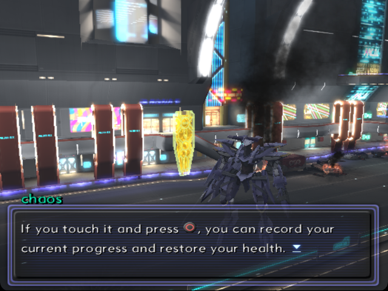

### Results, 2026-11-20, PCSX2 v2.9.175

The disc was booted twice: the first build, then the rebuild after the
review fixes (the commands above). The captures are of the rebuild, except
the Amharic save screen and `Saving...` (first build; the rebuild draws the
same Amharic bitmaps, on codes one cell further on, and was not saved
with) and the magnified smsg box (first build; 0006 has no glyph that
changed). Two more boots answered the party-name question: a scratch build
and the retail disc (below).

| Surface | Strings | Codes in them | Result |
|---|---|---|---|
| Movie subtitles (`s010100`) | 3 Hindi cues | lone 80-9F and A0-FF, AD80, AD82 | **seen**: drawn, centred per line, on time |
| cfe event lines (`sc8001`) | 0006-0008, Hindi | lone 80-9F and A0-FF, AD80, AD81, ADC0 | **seen**: drawn and centred, the three-line 0007 too |
| Field box, `talk.msgDtl` (`sc1010` 0004, 0005) | Arabic | A4A6-A4D1 pairs, AD85 | **seen**: joined, right to left, right edge at 410 px. On the first build AD85 (the sheen+yeh final ligature of الشيء in 0004) was cut off at column 20 and the word read like الثيء; the rebuild draws it whole |
| Field box, `talk.smsg` (`sc1010` 0006) | Arabic, two lines, `<○>` | A4 pairs | **seen**: both lines on one right edge, not re-wrapped (after the fix below) |
| Field menu party names (`MainMenu` 0000, 0003, 0012) | Georgian | lone 81 8D 8F 90 9D A0 A3 | **failed**: drawn blank, on both builds. The scratch test shows the name boxes are at fault, not these codes |
| Field box, scratch build (`sc1010` 0005) | Georgian | the same lone 81 8D 8F 90 9D A0 A3 | **seen**: all drawn |
| Field menu, scratch build (`MainMenu` 0000) | Hindi हिंसा | lone B1 B2 (both drawn in the movie) | **failed**: Copilot box blank |
| Save screen title (`MainMenu` 0512) | Amharic | lone D9-DB, AD83, AD84 | **seen** (first build) |
| `Saving...` (boot executable 0x68B678) | Amharic | lone D9-E0 | **seen** (first build) |
| Battle names (`batdat.us`) | Georgian | lone, first byte A3 | **not reached** |

| | |
|---|---|
| 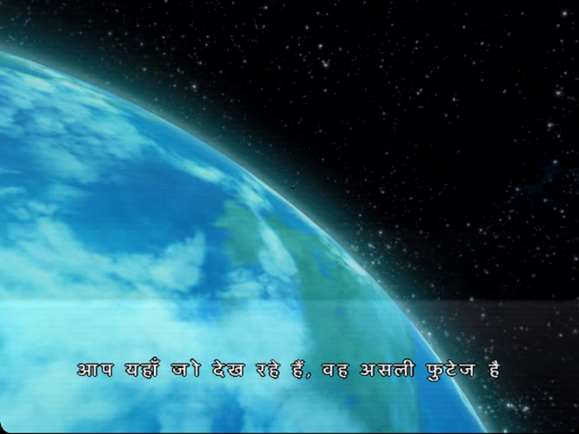 | 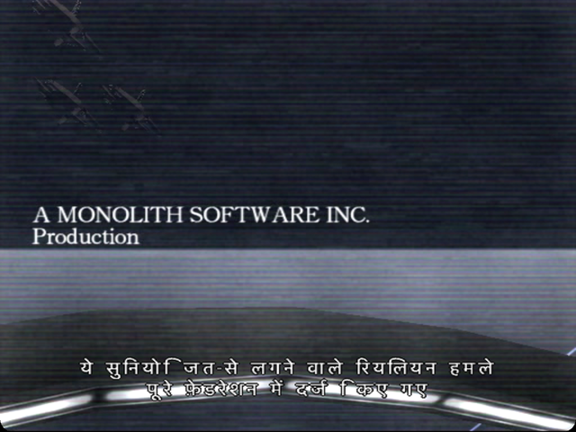 |
| 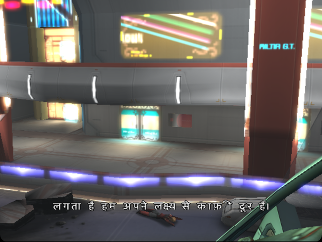 | 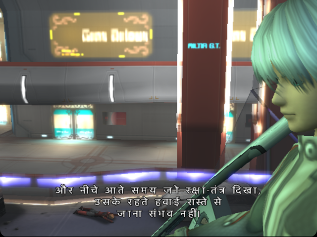 |
| 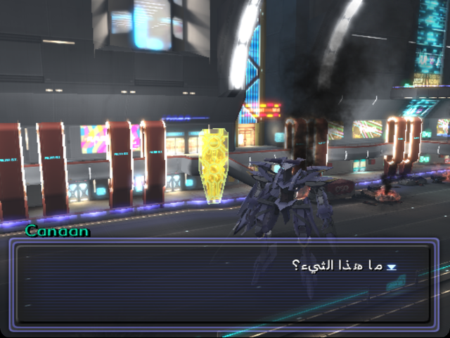 | 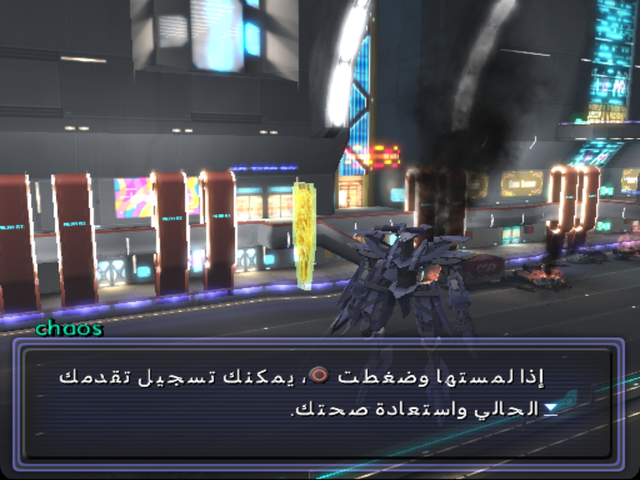 |
| 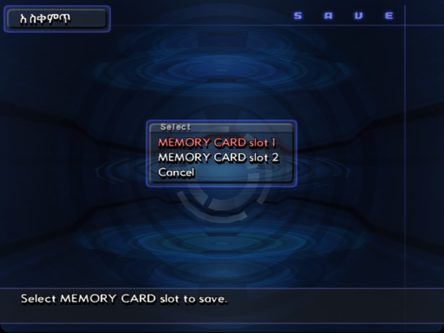 | 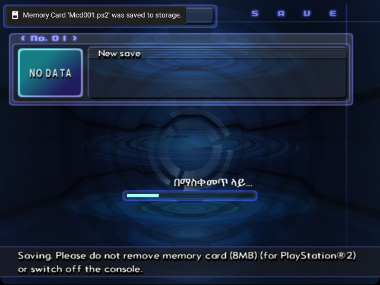 |
| 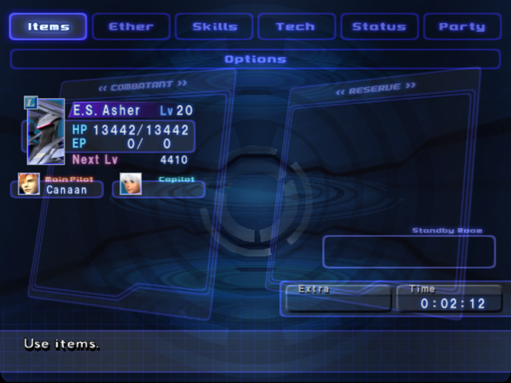 | 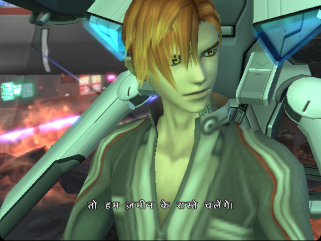 |

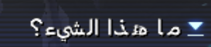

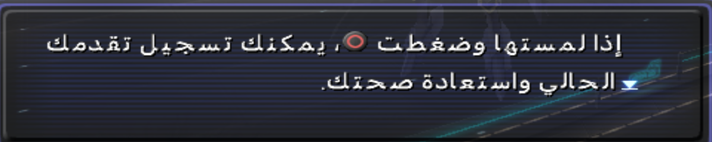

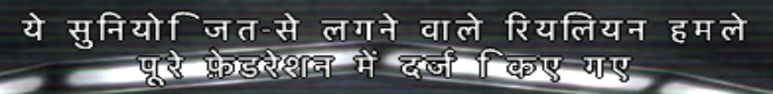

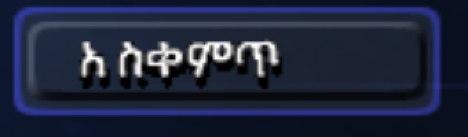
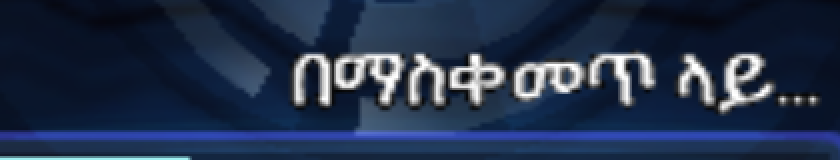

**The party names, tested.** The first reading of the blank names blamed
the name boxes because "the same bytes" draw elsewhere; a review pointed
out that the seven Georgian codes were used by no other string, so the
result could not tell the surface from the codes. A scratch build (not
kept; the LANGTEST fonts and tree with three blocks changed) settled it:
`sc1010` 0005 holds `ქაოსი ჯინ ქანაანი` (every one of the seven codes) and
`MainMenu.txd` 0000 holds `हिंसा`, written B1 B2, two single codes the
movie draws. The field window drew the Georgian; the Copilot box stayed
blank. The retail disc at the same point shows `chaos` as Copilot and
`Canaan` as Extra, so those boxes do come from 0000 and 0012 (Main Pilot
`Canaan` comes from somewhere else). The menu's name boxes draw nothing for
these strings whatever the codes; why has not been read. The save screen's
title, also a `MainMenu.txd` string, draws its high bytes, so it is not the
file either.

| | |
|---|---|
| 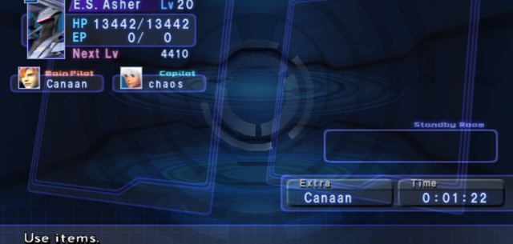 | 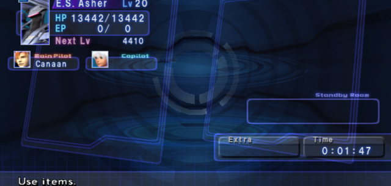 |

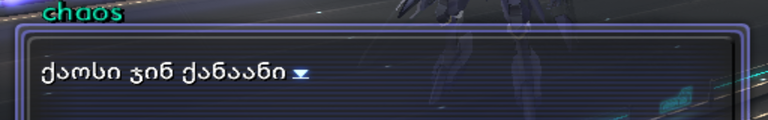

**The questions, answered:**

1. *Do lone high bytes draw?* Yes, 0x80-0x9F and 0xA0-0xFF, in the movie
   and in cfe lines (font0) and in the field window (font1: the codes 81
   8D 8F 90 9D A0 A3, scratch build); D9-E0 in a `.txd` menu string (the
   save screen's title) and in an executable string. Not in the field
   menu's party names, with either the Georgian codes or B1 B2. Not reached
   in battle.
2. *Do A4 pairs from A4A6 up and AD cells draw?* Yes: A4 pairs in the field
   box; AD cells in the field box (AD85), movie (AD80, AD82), cfe (AD80,
   AD81, ADC0, the last fixed code) and the save screen (AD83, AD84). A
   fixed cell advances 19 px whatever its ink, so a narrow letter on that
   tier leaves a gap after it (the `አ` of the save title).
3. *Are RTL lines left alone by the window's wrap?* Yes, at 410 px, on both
   lines of 0006.
4. *Are subtitle and cfe lines centred?* Yes, each line on its own.
5. *Does the battle HUD take names from `batdat.us` or `MainMenu.txd`?* Not
   reached. After the save point the next area (`sc1020`, Canaan's
   lock-on tutorial and a truck to shoot) came up, and about five minutes of
   walking past it did not start a battle. Since the menu's name boxes draw
   no translated name at all, a test should give `batdat.us` and
   `MainMenu.txd` different names and keep one of them in English.
6. *Which face does each surface use?* Not tested (no scratch build with
   different glyphs in the two faces). The code reading above stands.

### Notes from doing it

* **The button tag.** The first build of the day padded 0006 for its right
  edge counting `<` and `>` as letters, but the window draws the button
  picture and no brackets, so the line with `<○>` came out one bracket pair
  short of its neighbour (below). `langpack.py` now counts a `<○>`, `<△>`,
  `<□>` or `<×>` tag as wide as its symbol; the rebuilt disc lines up.
  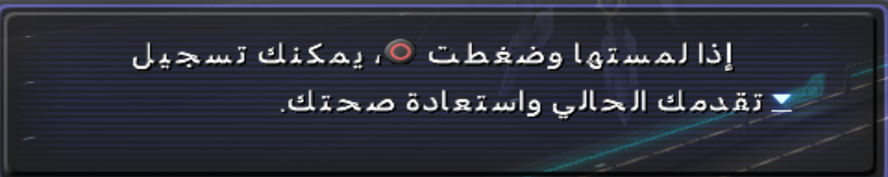
* **The space in the field window is 5 px.** With the default `--space-px 9`
  an earlier build's padded lines ended at different places; `--space-px 5`
  (`$xx1,4`) puts them on one edge.
* **The typewriter.** The field window types a line out byte by byte from
  the left. A right-to-left line is in visual order, so its end appears
  first, and the padding spaces in front of it are typed too: a short pause
  before a right-aligned line starts to show.
* **The party names.** With 0000, 0003 and 0012 in Georgian the field menu
  shows the Copilot and Extra name boxes empty, while Main Pilot still reads
  `Canaan` (that box takes its name from a string this tree did not change).
  See *The party names, tested* above: the name boxes, not the codes.
* **Glyphs that do not fit the cell.** SF Arabic's required ligature
  sheen+yeh final (`uni0634064A.fina`, in الشيء) is 25 px wide at 18 px/em.
  The scan put it on a fixed cell, 20 columns wide, and the five columns
  past the edge (the sheen's third tooth and the stroke that joins it to
  the lam) were lost without an error; the scan only said that two glyphs
  touched the cell's edge. The capture of 0004 shows the clipped word. The
  same scan of every slot found a 2 px loss on a Kohinoor conjunct (ADC0).
  `lang-scan` now draws a too-wide glyph narrower (AD85 at 78%, ADC0 at
  98%) and refuses one that loses ink above or below the cell; that refusal
  then caught the Hindi u-sign under सु and फु at 18 px, hence `--px 17.5`.
  The rebuilt disc draws the narrowed ligature whole (the magnified 0004
  above).
  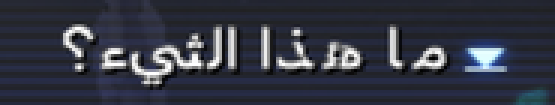
  ([the whole first-build capture](images/ingame-xs2-arabic-box-before-fix.png))
  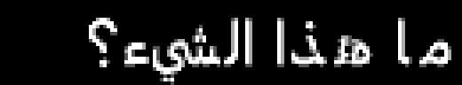
* **Devanagari spacing.** Without `--tight` the headline of Hindi words
  breaks between glyphs, and a short i (ि) that the shaper puts in its own
  cell (the cluster is wider than a cell) stands apart from its consonant
  (`सुनियो ि जत`, `ि कए`). Readable, but not good typesetting; `--tight`
  and smaller `--px` are the things to try next.
* **Re-exporting a translated disc.** `text-export` marks a bank string made
  of A4 pairs with a `#sjis:` comment line (its Shift-JIS hint reads the
  pair bytes as half-width kana). The comment is harmless; the string
  itself exports exactly.
* **exe-import and a partial tree.** `exe-import` refused the two-file
  executable tree because it opened every file the manifest lists; it now
  leaves an executable the tree does not hold as it is, and with `--retail`
  resets it to the retail bytes, so the result still equals an import into
  a fresh retail copy (self-tests for both).
* **Control tokens in right-to-left lines.** A review found that an `&NN`
  icon token inside an Arabic line came out mirrored and reversed (`&12` as
  `21&`); the LANGTEST lines have none. `<○>` escaped only because it reads
  the same backwards. Both are now placed like neutral punctuation and
  written verbatim (self-test).
* **Saving writes the memory card.** The save point opens the save screen
  directly (memory card slot, then a slot list, then *Is this okay?*). The
  card files were backed up before each boot and put back after; an
  accidental cursor move once reached *Format?* on the unformatted slot 2,
  answered No.

Driving the emulator without touching the desktop: PCSX2 started with
`open -g` and `-nogui -fastboot -batch`, pad presses posted to its PID with
`CGEventPostToPid` (the Cioppinosaga `bg_input.py` method, 300 ms holds,
Circle confirms), the game window captured by id with `screencapture -l`.
PCSX2 still made itself the active app twice when its game window first
appeared; focus was handed back to the previous app each time, and later
boots ran a small watcher that does so at once. Start, then Triangle, skips
a movie and a cfe event. From where the field starts, walking away from the
camera for about three seconds reaches the save point and its three lines;
the save point itself needs a few small steps to touch.
