# A tour of the Xenosaga Episode II extractor

This is the short, look-at-it version. Every section shows one thing the kit
does, the command that does it, and what comes out, using real output from the
USA discs. The reference pages ([FORMATS](FORMATS.md), [MODELS](MODELS.md),
[MUSIC](MUSIC.md), [MODDING](MODDING.md), ...) say how each format works and how
it was proven; this page only shows you the results.

The kit ships no game data. You need your own copy of the discs, and everything
below was produced from them.

**Contents:** [Setup](#setup) · [Models](#models) · [Textures](#textures) ·
[Menus and images](#menus-and-images) · [Fonts](#fonts) · [Dialogue](#dialogue) ·
[Scripts](#scripts) · [Sound effects and music](#sound-effects-and-music) ·
[Movies](#movies) · [Small files](#small-files) · [Changing the game](#changing-the-game) ·
[The window](#the-window) · [Also in the kit](#also-in-the-kit)

## Setup

```sh
python -m pip install -r requirements.txt      # once: numpy
python cli.py dump    --iso "Disc 1.iso" --iso "Disc 2.iso" --out out/ --code
python cli.py verify  --out out/
python cli.py browse  --out out/
```

`dump` unpacks the discs into `out/dump/` and writes `out/manifest.csv`, one row
per object on the disc. `browse` turns the dump into files your computer opens
and writes the result to `out/browse/`.

A row of `manifest.csv`:

```
area,path,sector,size,compressed,usize,sha1,kind,disc,bigfile,bigfile_offset
chain0,font0.us,53,492352,0,,6ec1aaed7987b9aa4f30007ac48826a1613b9f90,font,1,XENOSAGA.01,0
```

A run over both USA discs lists 9,043 objects. `chain0` is the part both discs share;
`chain1` and `chain2` are specific to Disc 1 and Disc 2.

What `browse` writes, by folder:

| Folder | What is in it | Files (both USA discs) |
|---|---|---|
| `models/` | every model as `.glb` | 946 |
| `textures_png/` | every texture page as PNG | 67,278 |
| `xtx/` | the UI sheets | 85 |
| `images/` | full-screen JPEGs (synopsis, game over, map pictures) | 36 |
| `fonts/` | font sheets and metrics | 10 |
| `text/` | dialogue, menus and quest text, as editable text | 833 |
| `scripts/` | every scene script, disassembled | 465 |
| `audio/` | sound effects as WAV | 3,733 |
| `music/` | the 31 songs: MIDI, SoundFont and rendered WAV | 124 |
| `movies/` | cutscenes as MP4 | 797 |
| `small/` | boot screens, title logos, battle strings, an index of side files | 212 |

Pick parts with `browse --kinds models,text,music` and so on; see
[BROWSING.md](BROWSING.md).

## Models

Every model on the disc becomes a `.glb` that Blender opens directly:
mesh, UVs, textures inside the file, vertex colours, skin weights and, for 562
of them, an armature whose bones sit on the mesh.

```sh
python cli.py browse --out out/ --kinds models          # all of them, about a minute
python cli.py model  --iso "Disc 1.iso" --path 'model\char\pc\kosmos00.pxy' --out kosmos00.glb   # just one
```

`out/browse/models.csv` says what each one has:

```
file,skeleton,textures,triangles,checks,status
model\char\pc\kosmos00.pxy,kosmos00.xhr,kosmos00.txy,2990,all pass,ok
```

Where to look first: `model/char/pc/` is the party, `model/char/npc/` the
people, `model/enemy/` the enemies and bosses, `model/robo/` the E.S. craft and
`model/map/` the places.

<table>
<tr>
<td>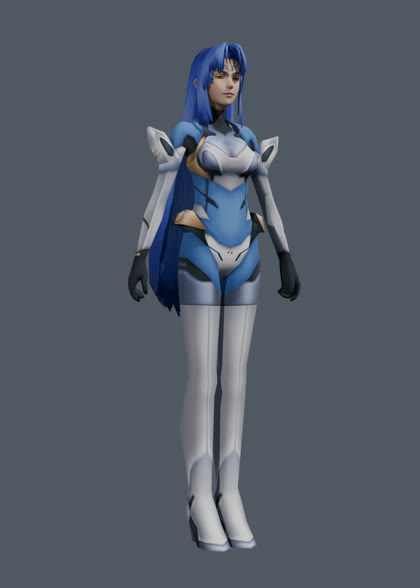<br><code>char/pc/kosmos00</code></td>
<td>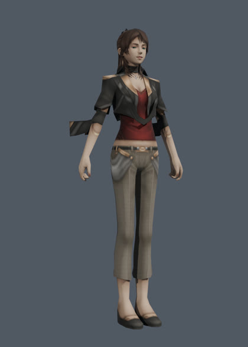<br><code>char/pc/shion00</code></td>
<td>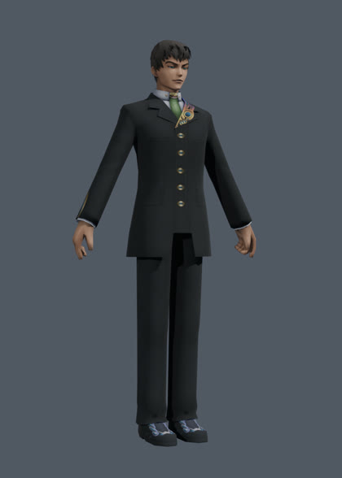<br><code>char/npc/gaignun00</code></td>
<td><br><code>char/npc/pope00</code></td>
</tr>
</table>

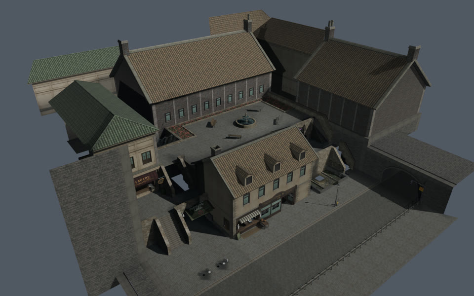 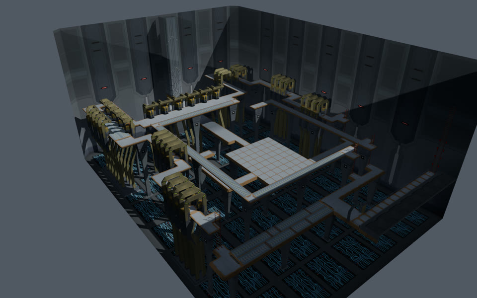

*`map/E2_KUK06` and `map/E2_MIL12`. More pictures are on the [front page](../README.md#gallery).*

Things to know before you open one:

* Open the `.glb` with File ▸ Import ▸ glTF 2.0, switch the viewport to
  **Material Preview** (the third shading ball) or it looks grey, and hide the
  **Bones** overlay if the importer's bone shapes look like balls. The steps are
  in [BLENDER.md](BLENDER.md).
* The figures here stand in the bind pose. The motion clips come with each
  model as animations ([MOTION.md](MOTION.md)).
* Maps include their sky domes. If a map looks boxed in or tiny, hide the
  biggest objects; `docs/gallery/render_gallery.py` shows one way.

## Textures

Every texture page on the disc is a PNG, named the way the artists named it.

```
textures_png/chain0/model/char/pc/kosmos00.txy/
    000_kosmos00_hair_col.png     011_kosmos00_body.png
    005_kosmos00_ude.png          017_kosmos00_asi.png
    023_kosmos00_eye.png          024_kosmos00_face.png   ...
```

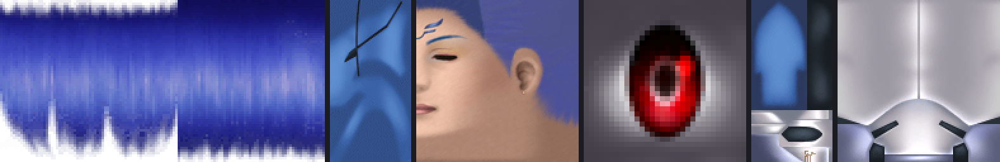

*From the left: `hair_col`, `body`, `face`, `eye`, `ude` (arm) and `asi` (leg) of
`kosmos00`, enlarged without smoothing. The textures are small and palette-based,
which is why they look soft.*

Skybox faces and animated pages come out one file per bank, and 1,333 more
textures come out of the pages embedded inside effect files
(`textures_png/_embedded/`).

## Menus and images

The `.xtx` sheets are the game's user-interface art: portraits, icons, the title
menu words. Full-screen pictures come out as JPEGs.

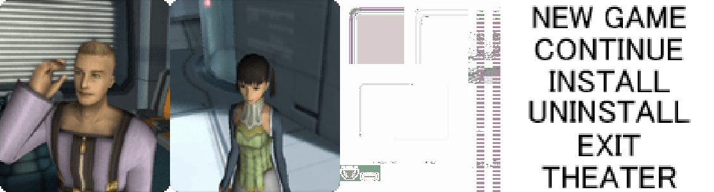

*`xtx/chain0/iwase/img/citizen/c01` and `c02` (citizen portraits), `omiya/talk01`
(interface pieces) and `yajima/titleobj` (the title menu: NEW GAME, CONTINUE,
INSTALL, ...).*

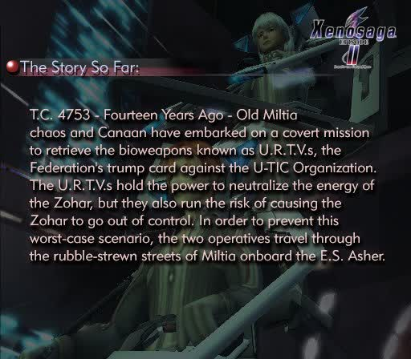 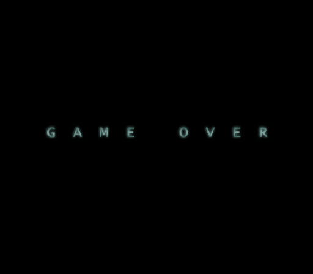

*`images/chain0/yajima/synopsis/01.jpg` ("The Story So Far") and `gameov1.jpg`.*

## Fonts

```sh
python cli.py font-extract --iso "Disc 1.iso" --out font/
```

You get the four glyph sheets of each font as PNG, a table of proportional
widths, and the byte-to-cell table that says which character each byte draws.


*`fonts/font0_us.sheet0.png`, the first of four sheets of the main font.*

```
slot,left,right
0,0,19
1,2,6
2,3,8
```

*`font0_us.metrics.csv`: a left and a right metric for each glyph slot.*
`font-rebuild` goes the other way, building a font file from edited sheets
([MODDING.md](MODDING.md)).

## Dialogue

There are three views of the same words, from raw to readable.

**1. Text banks, as the disc stores them.** `browse` and `text-export` write one
file per bank, with `### NNNN` markers you keep when you edit. This is the start
of `text/chain0/cf/en/sc1410.sbl.txt`:

```
### 0003
[Pitt]My son always asked me about work, so I finally got permission for him to look around.
### 0004
[Pitt]I would think a kid his age would enjoy going to a toy store a lot more than a lab.
### 0005
[Pitt]Please save my son!
```

Menus, quest text and citizen profiles come out the same way. `yosikawa/MainMenu.txd.txt`
starts with the party's names, and `iwase/Citizen.txt` holds the citizens:

```
No.1
{
	Name:"Sikes"
	Sex:"Male"
	Age:"28 years old"
	Hobby:"Visiting hot springs"
	Profile:"
A nice man who works for Sincere Deliveries. He\n
strives day and night to hand deliver sincerity\n
throughout Miltia."
}
```

**2. Every spoken line, in play order.**

```sh
python cli.py dialogue --iso "Disc 1.iso" --iso "Disc 2.iso" --out lines/ --voice
```

This writes `dialogue.csv`: speaker, text, which script and branch the line
belongs to, and the native call that shows it (columns trimmed below).

```
source,scene,order,speaker,text,native
script,sc1410,0,Pitt,"My son always asked me about work, so I finally got permission for him to look around.",talk.smsg
script,sc1410,1,Pitt,I would think a kid his age would enjoy going to a toy store a lot more than a lab.,talk.smsg
script,sc1410,2,Pitt,Please save my son!,talk.smsg
```

The full file also has the branch each line sits on (`if@05f0 > case 11@05f6 > ...`),
so you can tell which lines appear together. There are 8,318 lines from 363
scripts, plus battle callouts.

**3. Movie subtitles and voices.** The 45 cutscenes and 80 real-time events come
out as `.srt` files, and with `--voice` each timed line is cut from the movie's
soundtrack as its own WAV:

```
1
00:00:04,000 --> 00:00:06,467
I see.

2
00:00:06,467 --> 00:00:09,467
So this is the Y-Data.
```

*`subtitles/EP07.srt`.* The matching clips are `voice/EP07/01_I_see.wav`,
`02_So_this_is_the_Y_Dat.wav` and so on. Play a few in the
[audio table on the front page](../README.md#audio-samples). More in
[DIALOGUE.md](DIALOGUE.md).

## Scripts

Every scene and map script is a small program for the game's own script machine.
The kit disassembles all 465 of them, names every call into the game, and puts
each spoken line next to the instruction that shows it.

```sh
python cli.py sb --iso "Disc 1.iso" --path 'cf\sc1410.sb'     # one script
python cli.py natives --iso "Disc 1.iso" --iso "Disc 2.iso" --out natives/   # every native call
```

A piece of `scripts/chain0/cf/sc1410.sb.asm`: if variable `g23` is zero, say the
first Pitt line, and otherwise say the second.

```
  0610  push0
  0611  op        eq
  0614  jz        L_062c
  0617  pushtext  text#3    ; [Pitt]My son always asked me about work, so I finally got permission f
  061a  push3     ; type text
  061b  push      1
  061e  native    talk.smsg
  0621  drop
  ...
L_062c:
  062c  pushtext  text#4    ; [Pitt]I would think a kid his age would enjoy going to a toy store a l
```

Each script starts with the list of natives it calls (`runtime.mapChange`,
`runtime.getFlag`, `talk.smsg`, `camera.SetCamPos`, ...), which is a quick way to
see what a scene does. `natives` collects them all with argument types and call
counts. The machine is described in [SCRIPTS.md](SCRIPTS.md).

## Sound effects and music

**Sound effects.** 3,733 named samples from 1,074 sound banks, as WAV with their
loop points. `audio.csv` lists them:

```
index,name,rate,root,fine,loop,file,samples,peak,clipped,dc,bank
1,CFS00001.wav,22050,60,0,,001_CFS00001.wav,13020,8244,0,-2.2890168970814133,sound\vsf\SYS_SE.vsf
```

**Music.** The field and menu music is not recorded audio. The game plays 31
MIDI songs through a KORG sound driver on the PS2's sound chip, so the kit gives
you three things per song:

| File | What it is |
|---|---|
| `001_milchia.mid` | the song as stored (480 ticks per beat) |
| `001_milchia.sf2` | a SoundFont built from the song's own samples |
| `001_milchia.wav` | a render that follows the driver's rules and the sound chip's reverb |

```
song,mid,ppqn,ticks,sf2,wav,fx,seconds
001_milchia,001_milchia.mid,480,107760,001_milchia.sf2,001_milchia.wav,ECHO (return 90/127),118.1
```

Short clips of both are in [`samples/`](samples/) and listed in the
[front-page audio table](../README.md#audio-samples): five songs, a jingle, two
sound effects and three voice lines. How the renderer works and how it was
checked is in [MUSIC.md](MUSIC.md), which also says where it still differs from
the game.

## Movies

```sh
python cli.py browse --out out/ --kinds movies
```

`.sfd` cutscenes and `.ipu` monitor clips become MP4 (512×448, with their
stereo audio; `--movie-audio ac3` or `both` keeps the 5.1 track). 796 of the 797
in my run convert. `s010100`, the opening, runs about eight and a half minutes.

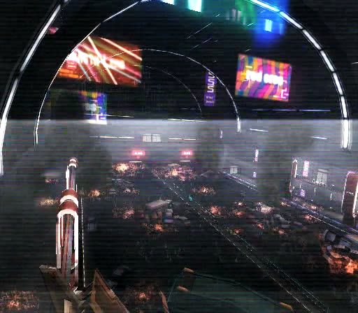

*A frame from `movies/chain1/movie/s010100.sfd.mp4`.*

## Small files

`browse --kinds small` unpacks the little files that do not fit anywhere else:
boot screens, the title logos, the save icon, and the battle database's strings.
`small.csv` says what every side file is:

```
area,path,what
chain0,yajima\title.bin,"title logo, raw 512x448 RGBA"
chain0,carddata.bin,"pack of 2: 1 ico, 1 sys"
```

`batdat.us.strings.csv` has the 1,085 battle strings, starting with the party:

```
section,offset,text
0,1380,chaos
0,1386,KOS-MOS
0,1394,Shion
0,1400,Jin
```

## Changing the game

Everything above reads the discs. These commands write a changed copy of a disc.
They never write over the original.

### Recolour a texture

```sh
python cli.py recolor --iso "Disc 1.iso" --dry-run --preview prev/      # look first; writes only PNGs
python cli.py recolor --iso "Disc 1.iso" --out pink.iso                 # KOS-MOS's hair, pink
```

`--dry-run --preview` writes a before and after PNG for every texture it would
change and touches no disc. On Disc 1 it finds 12 entries in 4 files, about 570
colours each:

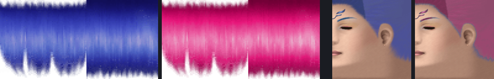

*`kosmos00_hair_col` and `kosmos00_face`, before (blue) and after (pink).*

The kit finds every copy of a texture by structure rather than by bytes, because
the game stores KOS-MOS's hair in several files at different offsets.

### Edit the text

```sh
python cli.py text-export --iso "Disc 1.iso" --out text/
# edit text/..., keeping the "### NNNN" lines and codes such as [Pitt], \n and $zoom13;
python cli.py text-import --iso "Disc 1.iso" --text text/ --out modded.iso
```

`text-import` says which limit an edit broke: menu and quest text may not need
more disc sectors than the original, battle strings may not get longer, and
dialogue banks can grow with `--grow`. It refuses a tree that came from another
disc, never writes over its input, and gives you a complete image or none. The
rules, and what was checked in an emulator, are in [MODDING.md](MODDING.md).

### Replace any file

```sh
python cli.py patch --iso "Disc 1.iso" --out modded.iso --set 'chain0:cf\en\sc1010.sbl=new.sbl' [--grow]
```

## The window

Prefer clicking to typing? `python gui.py`, or double-click `launch.command` on a
Mac (`launch.bat` on Windows, `launch.sh` on Linux). It opens a local page with
one card per command above. The cards are built from the command line itself, so
new commands appear on their own.

## Also in the kit

Merged after this tour was written; each has its own page, and the tour has no
section with pictures for them yet.

* **Motion**: the animation clips (`.xap`, `.fap`) come with every model as
  Blender animations ([MOTION.md](MOTION.md)).
* **New alphabets and executable strings**: `lang-scan`, `lang-encode` and
  `lang-preview` for scripts the USA font never had, and `exe-export` /
  `exe-import` for the strings inside the executable. A test disc with Arabic,
  Hindi, Georgian and Amharic was booted in PCSX2; one surface failed and one
  was not reached ([ALPHABETS.md](ALPHABETS.md), [MODDING.md](MODDING.md)).
* **Text coverage**: `text-coverage` lists every place the game shows text and
  what the kit does with it; control-code prompts, quest fields and the
  memory-card title are editable ([MODDING.md](MODDING.md)).
* **Texture import**: `texture-import` puts edited PNGs, UI sheets and model
  images back into a copy of the disc. Checked on disc copies, not yet seen in
  the running game ([MODDING.md](MODDING.md#editing-textures-texture-import)).
